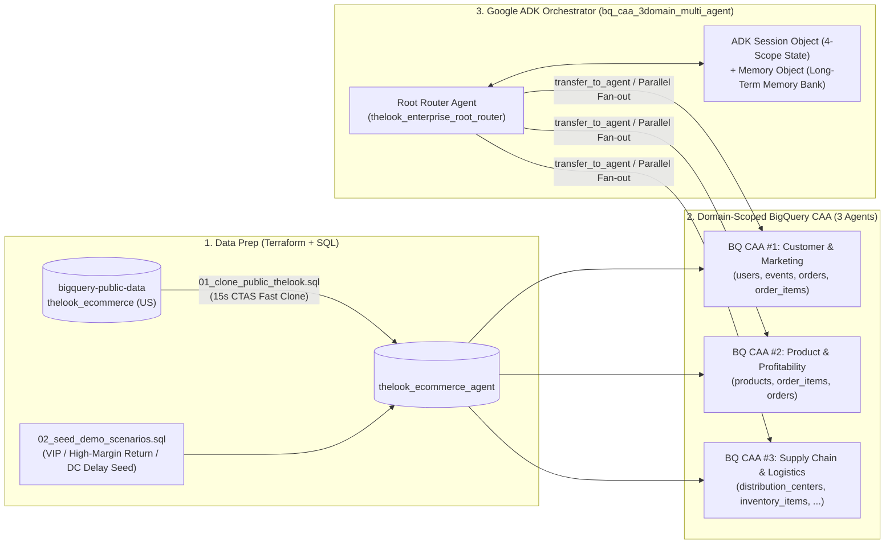

# BigQuery Conversational Analytics (CAA) & Google ADK Multi-Agent Hands-on Lab
**(Domain-Scoped 3-SubAgent Routing + ADK `Session Object` & `Memory Object` Architecture Pattern)**

[](https://cloud.google.com/bigquery)
[](https://adk.dev/)
[](./terraform/)

본 Repository는 사용자의 Google Cloud 환경에서 **`bigquery-public-data.thelook_ecommerce` 기반의 신규 Dataset(`<PROJECT_ID>.thelook_ecommerce_agent`, 기본 Region: `US`)을 자동으로 생성하고 Demo Scenario용 Golden Data를 증강**한 뒤, **Root Agent + 3대 Domain BigQuery CAA Sub-Agents Routing**과 **ADK `Session Object`(4-Scope State) + `Memory Object`(Long-Term Memory) Architecture Pattern**을 단계별로 구축·실습할 수 있도록 구성한 Qwiklabs 스타일 Hands-on Lab입니다.

> **공식 Integration Pattern 및 State Management 설계 배경 (`[확인됨 / Verified]`)**:
> Google Cloud 공식 문서([Integration patterns for data agents](https://cloud.google.com/gemini/docs/conversational-analytics-api/integration-patterns) 및 [State management for data agents](https://cloud.google.com/gemini/docs/conversational-analytics-api/state-management))에서는 BQ CAA 연동 방식을 크게 **Direct API, ADK, MCP, A2A의 4대 통합 접근법(7개 세부 패턴)**과 **3가지 API Context Mode(`ConversationReference`, `DataAgentContext`, `InlineContext`)**로 정의하고 있습니다. 본 Repository는 그중 엔터프라이즈 Multi-Agent 환경에서 Governance(Glossary/Verified Queries)가 보장되는 **핵심 패턴들(ADK `DataAgentToolset`, ADK `Custom Streaming Sub-Agent`, `Direct API Orchestrator`, `A2A`/`MCP`)**을 추려 비교하고, 실제 대규모 운영 시 발생하는 Token 비용 문제를 해결하기 위해 **ADK `Session`/`Memory` 기반의 경량 최적화 Best Practice**를 결합한 아키텍처 구현체입니다.

---

## 📚 Documentation Index

1. 📘 **[Qwiklabs Step-by-Step Hands-on Lab Guide (`docs/QWIKLABS_HANDSON_LAB_GUIDE_KO.md`)](docs/QWIKLABS_HANDSON_LAB_GUIDE_KO.md)**
   - **Overview & Setup → Task 1 ~ Task 5 단계별 실습 Command, 동작 원리, 왜 필요한가에 대한 상세 해설 및 `Check My Progress` 자가 진단 Script 안내**
2. 🏛️ **[Architecture Deep Dive Technical Whitepaper (`docs/ARCHITECTURE_DEEP_DIVE_KO.md`)](docs/ARCHITECTURE_DEEP_DIVE_KO.md)**
   - **Root Agent → 3 BQ CAA Sub-Agents Routing Logic (`transfer_to_agent`, `TransferToAgentTool` Enum 제약, Peer-to-Peer 전환, `run_cross_domain_caa_analysis` 병렬 Fan-out)**
   - **ADK 표준 `Session Object` (`temp:`, `session`, `user:`, `app:` 4-Scope State) + `Memory Object` (`add_session_to_memory`, `preload_memory`, `load_memory`, `.adk/long_term_memory_bank.json`) 설계 원리**
3. 🔍 **[Code Walkthrough & Session/Memory API Reference (`docs/CODE_WALKTHROUGH_ROOT_AGENT_AND_SESSION_KO.md`)](docs/CODE_WALKTHROUGH_ROOT_AGENT_AND_SESSION_KO.md)**
   - **Repository 내 `.py` File별 역할 구분 및 `bq_caa_3domain_multi_agent/agent.py` Line별 Code Map (`root_agent`, 3개 Domain Sub-Agent, 병렬 분석 Tool)**
   - **Session 및 Memory 제어를 위해 호출하는 Google ADK 표준 Library(`CallbackContext`, `ToolContext`, `Event`, `preload_memory`, `load_memory`) 및 5대 내부 Function 상세 분석**

---

## 🏗️ System Architecture & Key Value Propositions



### 왜 이 Architecture가 필요한가? (Key Value Propositions)

| 핵심 과제 | 기존 단일 Agent 또는 기본 단발성 호출의 한계 | 본 Architecture의 해결 방식 (`bq_caa_3domain_multi_agent`) |
| :--- | :--- | :--- |
| **1. Domain Routing 및 Token/정확도 최적화** | 모든 Table과 Business Glossary를 1개 CAA Agent에 연결하거나 매번 `list`/`get_data_agent_info`를 호출하여 입력 Token 급증 및 유사 Column(`created_at`) 오조인 발생 | **Root Agent + 3 Domain-Scoped CAA Sub-Agents**: Domain별 필수 Table(4/3/5개)과 전용 Business Glossary만 분리 연결하고, 정적 `agent_id` Tool Binding(메타데이터 탐색 Token 0)과 `transfer_to_agent` / `ThreadPoolExecutor` 병렬 Fan-out으로 처리 |
| **2. Multi-Turn 대화 Context 유지 및 Token 상한 관리 (`Session Object`)** | ADK 기본 `ask_data_agent`는 매 요청에 현재 질문 1개만 전달(One-Shot Stateless)하여 후속 질문에서 이전 SQL 조건 유실 (반면 관리형 `ConversationReference`는 `1 Conversation = 1 Agent` 제약으로 도메인 전환 불가) | **Stateless API(`DataAgentContext`) + ADK 4-Scope `Session.state` (`temp:`, `session`, `user:`, `app:`)**: 동일 Domain은 `domain_ca_multiturn_messages[-6:]`(최근 3 Turn)를 CAA `:chat` API의 `messages` 배열에 자동 Chaining하고, 이종 Domain 간에는 `domain_query_history` 기반 완결형 질의 재작성(Standalone Query Rewriting) 및 Tool 반환값 경량화(20행 요약 + `THOUGHT`/`PROGRESS` 제거) 적용 |
| **3. Cross-Session Long-Term Memory (`Memory Object`)** | 새 채팅(`+ New Session`) 생성 시 사용자의 담당 부서·중점 KPI·이전 분석 Insight 초기화 | **`after_agent_callback`(`add_session_to_memory`) + `preload_memory` / `load_memory` + `.adk/long_term_memory_bank.json`**: 새 Session을 열거나 Server를 재시작해도 사용자 Profile(`user:profile`)과 과거 분석 결론을 즉시 복원 |

---

## 📂 Repository Directory Structure

```text
.
├── README.md                                     # Repository 개요 및 Quickstart Guide
├── docs/
│   ├── QWIKLABS_HANDSON_LAB_GUIDE_KO.md            # [필독] Qwiklabs 형식 단계별 Hands-on Lab Guide (Task 1~5)
│   ├── ARCHITECTURE_DEEP_DIVE_KO.md                # Routing Logic 및 Session/Memory Architecture 심층 해설서
│   └── CODE_WALKTHROUGH_ROOT_AGENT_AND_SESSION_KO.md # Root Agent 구성 .py Code Map & Session/Memory API Reference
├── scripts/
│   ├── 00_configure_customer_env.sh              # 사용자 정보(PROJECT_ID, DATASET_ID, REGION) 대화형 설정 Wizard
│   ├── 01_prepare_bigquery_data.py               # Public Data 복제(15초 CTAS) + 3대 Domain Demo Data Seeding
│   ├── 02_provision_bq_caa_agents.py             # 6개 BigQuery CAA Agent 자동 Provisioning
│   └── 03_verify_lab_progress.py                 # Qwiklabs 'Check My Progress' 스타일 단계별 완료 검증기
├── terraform/
│   ├── versions.tf                               # Terraform & Google Provider Version 정의
│   ├── variables.tf                              # project_id, dataset_id(thelook_ecommerce_agent), bq_location(US)
│   ├── main.tf                                   # GCP API 활성화 + BigQuery Dataset + Data/CAA Provisioning
│   ├── outputs.tf                                # Provisioning 결과 출력 (Student Visible Outputs)
│   └── terraform.tfvars.example                  # 사용자 Variable 입력 예시 File
├── sql/
│   ├── 01_clone_public_thelook.sql               # bigquery-public-data.thelook_ecommerce 7개 Table 복제 SQL
│   └── 02_seed_demo_scenarios.sql                # VIP 사용자 / 고마진 반품 Anomaly / 물류센터 배송지연 Seed SQL
├── bq_caa_3domain_multi_agent/                   # [Main Lab] Root Router + 3 Domain CAA Sub-Agents + Session/Memory
├── bq_caa_toolset_agent/                         # [Comparison] Single CAA Agent (Baseline vs Governed 비교용)
├── bq_caa_streaming_agent/                       # [Streaming] Deterministic Multi-Turn Streaming + State Handoff
├── setup_mac_adk.sh                              # 원클릭 Python .venv + SSL 인증서 Bundle + ADK Web UI Launcher
├── run_adk_web.sh                                # ADK Web UI (http://127.0.0.1:8000/dev-ui/) 빠른 재실행 Script
└── pyproject.toml                                # Python Package 의존성 정의 (google-adk, google-genai, truststore 등)
```

---

## 🚀 5분 Quickstart (사용자 환경 실행 순서)

### Step 1. 사용자 GCP Project 정보 설정 (`thelook_ecommerce_agent`, Region `US` 기본값)
```bash
chmod +x scripts/00_configure_customer_env.sh setup_mac_adk.sh run_adk_web.sh
./scripts/00_configure_customer_env.sh
source customer_config.env
```

### Step 2. BigQuery Dataset 복제 + Scenario Data 추가 + CAA Agent 생성
- **방법 A (Python Script 실행 — 약 40초 완료)**:
  ```bash
  python3 scripts/01_prepare_bigquery_data.py
  python3 provision_bq_caa_demo.py
  ```
- **방법 B (Terraform 일괄 실행)**:
  ```bash
  cd terraform && terraform init && terraform apply -auto-approve && cd ..
  ```

### Step 3. 실습 환경 자가 검증 (`Check My Progress`)
```bash
python3 scripts/03_verify_lab_progress.py --all
```

### Step 4. Google ADK Web UI 실행 및 실습 진행
```bash
./setup_mac_adk.sh "$GOOGLE_CLOUD_PROJECT" "$BQ_DATASET_ID"
```
Browser에서 **[http://127.0.0.1:8000/dev-ui/](http://127.0.0.1:8000/dev-ui/)** 접속 후 상세 Prompt Scenario는 **[`docs/QWIKLABS_HANDSON_LAB_GUIDE_KO.md`](docs/QWIKLABS_HANDSON_LAB_GUIDE_KO.md)**의 **Task 4 & Task 5**를 따라 진행하세요.
