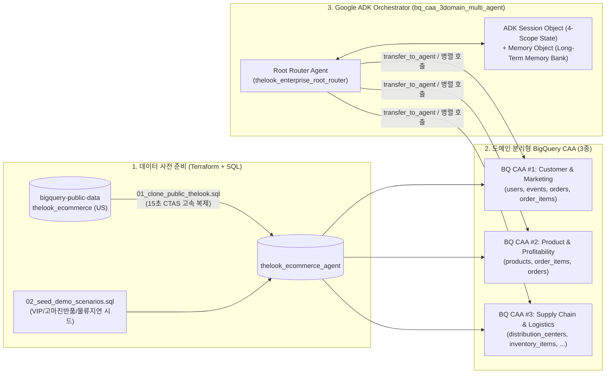

# BigQuery Conversational Analytics (CAA) & Google ADK Multi-Agent Hands-on Lab
**(Domain-Scoped 3-SubAgent Routing + ADK Standard `Session Object` & `Memory Object` Architecture)**

[](https://cloud.google.com/bigquery)
[](https://adk.dev/)
[](./terraform/)

본 리포지토리는 고객사의 Google Cloud 환경에서 **`bigquery-public-data.thelook_ecommerce` 기반의 신규 데이터셋(`<PROJECT_ID>.thelook_ecommerce_agent`, 기본 리전: `US`)을 자동으로 생성하고 데모 시나리오용 골든 데이터를 증강**한 뒤, **Root Agent + 3대 도메인 BigQuery CAA Sub-Agents 라우팅**과 **ADK 표준 `Session Object`(4-Scope State) + `Memory Object`(장기 기억) 아키텍처**를 단계별로 구축·실습할 수 있도록 패키징된 Qwiklabs 스타일 핸즈온 랩입니다.

---

## 📚 문서 가이드 (Documentation Index)

1. 📘 **[Qwiklabs 단계별 핸즈온 실습 가이드 (`docs/QWIKLABS_HANDSON_LAB_GUIDE_KO.md`)](docs/QWIKLABS_HANDSON_LAB_GUIDE_KO.md)**
   - **Overview & Setup → Task 1 ~ Task 5 단계별 실습 명령어, 동작 원리, 왜 필요한가에 대한 상세 해설, 그리고 `Check My Progress` 자가 진단 스크립트 안내**
2. 🏛️ **[아키텍처 심층 기술 백서 (`docs/ARCHITECTURE_DEEP_DIVE_KO.md`)](docs/ARCHITECTURE_DEEP_DIVE_KO.md)**
   - **Root Agent → 3 BQ CAA Sub-Agents 라우팅 로직 (`transfer_to_agent`, `TransferToAgentTool` Enum 제약, Peer-to-Peer 전환, `run_cross_domain_caa_analysis` 병렬 Fan-out)**
   - **ADK 표준 `Session Object` (`temp:`, `session`, `user:`, `app:` 4-Scope State) + `Memory Object` (`add_session_to_memory`, `preload_memory`, `load_memory`, `.adk/long_term_memory_bank.json`) 설계 원리**
3. 🔍 **[코드 워크스루 & Session/Memory API 레퍼런스 (`docs/CODE_WALKTHROUGH_ROOT_AGENT_AND_SESSION_KO.md`)](docs/CODE_WALKTHROUGH_ROOT_AGENT_AND_SESSION_KO.md)**
   - **리포지토리 내 `.py` 파일별 역할 구분 및 `bq_caa_3domain_multi_agent/agent.py` 라인별 코드 맵 (`root_agent`, 3개 도메인 Sub-Agent, 병렬 분석 Tool)**
   - **Session 및 Memory 제어를 위해 호출하는 Google ADK 표준 라이브러리(`CallbackContext`, `ToolContext`, `Event`, `preload_memory`, `load_memory`) 및 5대 내부 함수 상세 분석**

---

## 🏗️ 전체 시스템 아키텍처 및 핵심 특장점



### 왜 이 아키텍처가 필요한가? (Key Value Propositions)

| 핵심 과제 | 기존 단일 NL2SQL 에이전트의 한계 | 본 아키텍처의 해결 방식 (`bq_caa_3domain_multi_agent`) |
| :--- | :--- | :--- |
| **1. 도메인 라우팅 및 토큰/정확도 최적화** | 모든 테이블과 용어집을 1개 CAA에 연결하여 입력 토큰 폭증 및 유사 컬럼(`created_at`) 오조인 발생 | **Root Agent + 3 Domain-Scoped CAA Sub-Agents**: 도메인별 필수 테이블(4/3/5개)과 전용 용어집만 분리 연결하고, 단일 도메인은 `transfer_to_agent`, 복합 도메인은 `ThreadPoolExecutor` 병렬 Fan-out으로 처리 |
| **2. 멀티턴 대화 맥락 유지 (`Session Object`)** | 후속 질문("그 중 상위 5개만")에서 이전 SQL 조건 유실 | **ADK 4-Scope `Session.state` (`temp:`, `session`, `user:`, `app:`)**: `domain_query_history` 및 `domain_ca_multiturn_messages`로 도메인별 직전 3턴 대화를 CAA `:chat` API에 자동 체이닝 |
| **3. 세션 간 장기 기억 (`Memory Object`)** | 새 채팅(`+ New Session`) 생성 시 사용자의 담당 부서·중점 KPI·이전 분석 인사이트 초기화 | **`after_agent_callback`(`add_session_to_memory`) + `preload_memory` / `load_memory` + `.adk/long_term_memory_bank.json`**: 새 세션을 열거나 서버를 재시작해도 사용자 프로필(`user:profile`)과 과거 분석 결론을 즉시 복원 |

---

## 📂 리포지토리 디렉토리 구조

```text
.
├── README.md                                  # 리포지토리 개요 및 Quickstart 가이드
├── docs/
│   ├── QWIKLABS_HANDSON_LAB_GUIDE_KO.md            # [필독] Qwiklabs 형식 단계별 핸즈온 실습 가이드 (Task 1~5)
│   ├── ARCHITECTURE_DEEP_DIVE_KO.md                # 라우팅 로직 및 Session/Memory 아키텍처 심층 해설서
│   └── CODE_WALKTHROUGH_ROOT_AGENT_AND_SESSION_KO.md # Root Agent 구성 .py 코드 맵 & Session/Memory API 레퍼런스
├── scripts/
│   ├── 00_configure_customer_env.sh           # 고객 정보(PROJECT_ID, DATASET_ID, REGION) 대화형 설정 마법사
│   ├── 01_prepare_bigquery_data.py            # 퍼블릭 데이터 복제(15초 CTAS) + 3대 도메인 데모 데이터 시딩
│   ├── 02_provision_bq_caa_agents.py          # 6개 BigQuery CAA 에이전트 자동 프로비저닝
│   └── 03_verify_lab_progress.py              # Qwiklabs 'Check My Progress' 스타일 단계별 완료 검증기
├── terraform/
│   ├── versions.tf                            # Terraform & Google Provider 버전 정의
│   ├── variables.tf                           # project_id, dataset_id(thelook_ecommerce_agent), bq_location(US)
│   ├── main.tf                                # GCP API 활성화 + BigQuery Dataset + 데이터/CAA 프로비저닝
│   ├── outputs.tf                             # 프로비저닝 결과 출력 (Student Visible Outputs)
│   └── terraform.tfvars.example               # 고객 변수 입력 예시 파일
├── sql/
│   ├── 01_clone_public_thelook.sql            # bigquery-public-data.thelook_ecommerce 7개 테이블 복제 SQL
│   └── 02_seed_demo_scenarios.sql             # VIP 고객 / 고마진 반품 이상징후 / 물류센터 배송지연 시드 SQL
├── bq_caa_3domain_multi_agent/                # [Main Lab] Root Router + 3 Domain CAA Sub-Agents + Session/Memory
├── bq_caa_toolset_agent/                      # [Comparison] Single CAA Agent (Baseline vs Governed 비교용)
├── bq_caa_streaming_agent/                    # [Streaming] Deterministic Multi-Turn Streaming + State Handoff
├── setup_mac_adk.sh                           # 원클릭 Python .venv + SSL 인증서 번들 + ADK Web UI 런처
├── run_adk_web.sh                             # ADK Web UI (http://127.0.0.1:8000/dev-ui/) 빠른 재실행 스크립트
└── pyproject.toml                             # Python 패키지 의존성 정의 (google-adk, google-genai, truststore 등)
```

---

## 🚀 5분 Quickstart (고객 환경 실행 순서)

### Step 1. 고객 GCP 프로젝트 정보 설정 (`thelook_ecommerce_agent`, 리전 `US` 기본값)
```bash
chmod +x scripts/00_configure_customer_env.sh setup_mac_adk.sh run_adk_web.sh
./scripts/00_configure_customer_env.sh
source customer_config.env
```

### Step 2. BigQuery 데이터셋 복제 + 시나리오 데이터 추가 + CAA 에이전트 생성
- **방법 A (Python 스크립트 실행 — 약 40초 완료)**:
  ```bash
  python3 scripts/01_prepare_bigquery_data.py
  python3 provision_bq_caa_demo.py
  ```
- **방법 B (Terraform 일괄 실행)**:
  ```bash
  cd terraform && terraform init && terraform apply -auto-approve && cd ..
  ```

### Step 3. 실습 환경 자가 검증 (`Check My Progress`)
```bash
python3 scripts/03_verify_lab_progress.py --all
```

### Step 4. Google ADK Web UI 실행 및 실습 진행
```bash
./setup_mac_adk.sh "$GOOGLE_CLOUD_PROJECT" "$BQ_DATASET_ID"
```
브라우저에서 **[http://127.0.0.1:8000/dev-ui/](http://127.0.0.1:8000/dev-ui/)** 접속 후 상세 프롬프트 시나리오는 **[`docs/QWIKLABS_HANDSON_LAB_GUIDE_KO.md`](docs/QWIKLABS_HANDSON_LAB_GUIDE_KO.md)**의 **Task 4 & Task 5**를 따라 진행하세요.
