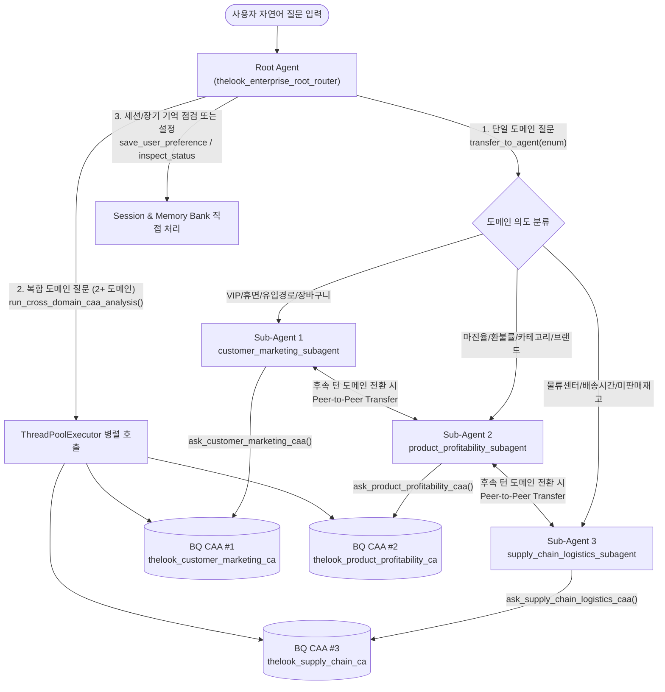
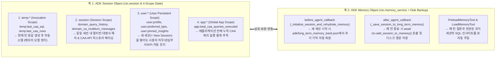

# [기술 백서] Google ADK + BigQuery CAA 멀티 에이전트 아키텍처 심층 해설
**(Root-to-SubAgent 라우팅 메커니즘 및 ADK 표준 `Session Object` + `Memory Object` 아키텍처)**

---

## 1. 왜 단일 에이전트가 아닌 `Root + 3 Domain-Scoped BQ CAA` 멀티 에이전트인가?

엔터프라이즈 데이터 웨어하우스(수십~수백 개 테이블, 수백 개 비즈니스 지표)를 단 하나의 BigQuery Conversational Analytics(CAA) 에이전트에 모두 연결하면 다음과 같은 **3가지 구조적 병목**이 발생합니다 (`[확인됨 / Verified]`):

1. **입력 토큰 폭증 (Prompt Bloat & Cost Spike)**:
   - 단일 CAA 에이전트에 많은 테이블과 방대한 시스템 지침(비즈니스 용어집 전체)을 연결하면, 매 질문마다 전체 스키마 메타데이터·샘플 값·용어집이 내부 프롬프트에 주입되어 **질문 1회당 수만~10만+ 입력 토큰**이 소모됩니다.
2. **유사 컬럼 간 오조인 (Cross-Domain Schema Confusion)**:
   - 예를 들어 `users.created_at`(가입일), `orders.created_at`(주문일), `inventory_items.created_at`(입고일)이 한 에이전트에 섞여 있으면 LLM이 "지난 달 신규 사용자의 주문"을 계산할 때 잘못된 테이블의 날짜 컬럼을 조인할 확률이 높아집니다.
3. **복합 도메인 질문 시 거대 SQL Fan-out 오류**:
   - 사용자 이벤트(`events`, 수백만 행), 주문 상세(`order_items`), 재고(`inventory_items`)를 단일 SQL 쿼리에서 한 번에 `JOIN`하면 다대다(N:M) 카테시안 곱(Fan-out)이 발생하여 집계 수치가 왜곡됩니다.

### 해결책: 도메인별 테이블 스코핑(Table Scoping) + 계층형 ADK 오케스트레이션

본 아키텍처는 `thelook_ecommerce_agent` 데이터셋의 7개 테이블과 10대 비즈니스 용어를 **3개의 독립된 비즈니스 도메인 CAA 에이전트**로 분리하고, 상단에 **ADK Root Router Agent**를 배치합니다.

| 도메인 구분 | ADK Sub-Agent 이름 | 연결된 BigQuery CAA 리소스 ID | 스코핑된 테이블 (최소 권한 원칙) | 전담 비즈니스 용어집 (SQL 매핑 규칙) |
| :--- | :--- | :--- | :--- | :--- |
| **Domain 1 (사용자 & 마케팅)** | `customer_marketing_subagent` | `thelook_customer_marketing_ca` | `users`, `events`, `orders`, `order_items` (4개) | VIP 사용자, 이탈/휴면 사용자, 신규 가입 사용자, 유입 경로(`traffic_source`), 장바구니 포기율, AOV/ARPU |
| **Domain 2 (상품 & 수익성)** | `product_profitability_subagent` | `thelook_product_profitability_ca` | `products`, `order_items`, `orders` (3개) | 상품 마진율, 순매출액(Net Revenue), 실판매 마진액, 반품/취소 건, 취소/반품 비율(환불률) |
| **Domain 3 (물류 & 재고)** | `supply_chain_logistics_subagent` | `thelook_supply_chain_ca` | `distribution_centers`, `inventory_items`, `order_items`, `orders`, `products` (5개) | 물류 센터(DC/창고), 평균 배송 소요 시간(리드타임), 출고 리드타임, 미판매 재고율, 재고 원가 총액 |

---

## 2. Root Agent가 Sub-Agent(BQ CAA)를 라우팅하는 내부 로직 상세 해설

`bq_caa_3domain_multi_agent/agent.py`의 라우팅은 질문의 성격에 따라 **3가지 경로(Path A / B / C)**로 작동하며, Google ADK 런타임(`google.adk.flows.llm_flows.agent_transfer`)의 내부 메커니즘과 긴밀하게 결합되어 있습니다 (`[확인됨 / Verified: agent_transfer.py & transfer_to_agent_tool.py]`).

### 2.1 [Path A] 단일 도메인 질문 — ADK Built-in `transfer_to_agent` 위임 메커니즘
1. **프롬프트 자동 주입 (`_AgentTransferLlmRequestProcessor`)**:
   - `root_agent`에 `sub_agents=[customer_marketing_subagent, product_profitability_subagent, supply_chain_logistics_subagent]`를 선언하면, ADK 런타임이 매 턴 LLM 호출 직전에 각 Sub-Agent의 `name`과 `description`을 시스템 프롬프트에 자동 주입합니다.
2. **JSON Schema `enum` 제약 (`TransferToAgentTool`)**:
   - ADK는 `transfer_to_agent(agent_name: str)` 도구를 생성할 때 파라미터 스키마에 `enum: ["customer_marketing_subagent", "product_profitability_subagent", "supply_chain_logistics_subagent"]` 제약을 강제합니다. 따라서 LLM이 존재하지 않는 에이전트 이름을 환각(Hallucination)으로 생성하는 것이 불가능합니다.
3. **동일 턴 내 즉시 제어권 스위칭 (`EventActions.transfer_to_agent`)**:
   - Root Agent가 `transfer_to_agent(agent_name="customer_marketing_subagent")`를 호출하면 `tool_context.actions.transfer_to_agent` 플래그가 설정됩니다.
   - ADK `Runner`가 이 플래그를 가로채어 **사용자 추가 입력 없이 동일 턴 안에서 즉시 `customer_marketing_subagent`를 실행**합니다.
4. **전용 도구를 통한 1:1 CAA 바인딩**:
   - 깨어난 `customer_marketing_subagent`는 오직 `ask_customer_marketing_caa` 도구만 보유하고 있으므로, 무조건 `thelook_customer_marketing_ca` 에이전트로만 쿼리를 전송합니다.

### 2.2 [Path B] 멀티턴 후속 질문의 도메인 전환 — Peer-to-Peer & Parent Transfer
- Turn 1에서 `customer_marketing_subagent`가 응답을 마치면, 세션의 현재 활성 에이전트는 `customer_marketing_subagent`가 됩니다.
- Turn 2에서 사용자가 **"그럼 물류센터별 평균 배송 소요 시간은 어때?"**(Domain 3 질문)라고 물으면 어떻게 될까요?
- ADK의 `_get_transfer_targets(agent)` 함수는 현재 활성 Sub-Agent에게 **(1) 부모 에이전트(`thelook_enterprise_root_router`)**와 **(2) 형제 에이전트(`product_profitability_subagent`, `supply_chain_logistics_subagent`)**를 모두 이관 대상으로 열어 줍니다.
- 따라서 `customer_marketing_subagent`는 Root를 거치지 않고 곧바로 `transfer_to_agent(agent_name="supply_chain_logistics_subagent")`를 호출하여 **수평 이관(Peer Transfer)**을 수행합니다.

### 2.3 [Path C] 복합 도메인 질문 — `run_cross_domain_caa_analysis` 병렬 Fan-out
- 사용자가 한 문장 안에 2~3개 도메인의 지표를 동시에 요구할 때(예: *"유입 경로별 VIP 사용자 수, 상품 카테고리별 평균 마진율, 물류센터별 평균 배송 소요 시간을 한 번에 종합 보고서로 비교해줘"*), 단일 Sub-Agent로 제어권을 넘기면 다른 도메인의 테이블을 조회할 수 없습니다.
- 이때 Root Agent는 제어권을 넘기지 않고 직접 `run_cross_domain_caa_analysis(...)` 도구를 호출합니다.
- 이 도구는 질문을 도메인별 하위 쿼리로 분해(Query Decomposition)한 뒤, Python `ThreadPoolExecutor`를 통해 **3개 도메인 CAA 에이전트의 `:chat` API를 동시에 병렬 호출**하여 대기 시간을 약 60% 단축하고 하나의 경영진 종합 리포트로 합성합니다.

---

## 3. 왜 "ADK 표준 `Session Object` + `Memory Object` 아키텍처"가 필요한가?

### 3.1 기존 Stateless / 단순 NL2SQL 에이전트의 3대 한계점
1. **턴 간 맥락 단절 (In-Session Amnesia)**:
   - Turn 1에서 *"Women 부서의 고마진 카테고리를 보여줘"*라고 물은 뒤 Turn 2에서 *"그 중 환불률이 가장 높은 브랜드는?"*이라고 물으면, 이전 턴의 생성 SQL과 조건을 기억하지 못해 전체 부서를 대상으로 잘못된 SQL을 생성합니다.
2. **세션 종료 후 사용자 컨텍스트 초기화 (Cross-Session Amnesia)**:
   - 현업 사용자(예: 여성복 MD 팀장)가 매번 새 채팅창(`+ New Session`)을 열 때마다 *"나는 여성복(Women) 부서 담당이고 마진율과 환불률을 중점 관리해"*라고 반복해서 설명해야 합니다.
3. **도구 실행 결과의 휘발**:
   - 이전 세션에서 도출했던 중요한 분석 결론(예: *"Outerwear 카테고리의 마진율이 52.4%로 1위이나 TheLook Atelier 브랜드의 반품률이 비정상적으로 높음"*)이 다음 날 회의 시점에는 사라져 다시 쿼리 비용을 지불해야 합니다.

### 3.2 본 아키텍처에서 강화된 2대 핵심 축: `Session Object` & `Memory Object`

#### 강화 포인트 상세 비교표

| 구분 | 미적용 시 (일반 NL2SQL 에이전트) | **적용 후 (`bq_caa_3domain_multi_agent`)** | 구현 코드 위치 (`agent.py`) |
| :--- | :--- | :--- | :--- |
| **단일 턴 임시 데이터 관리** | 조회된 대량 행 데이터가 세션 전체에 남아 토큰 낭비 유발 | **`temp:last_caa_rows` / `temp:last_caa_sql`**에 저장되어 해당 턴 종료 즉시 자동 정리(Garbage Collection) | `_record_caa_result_into_session_state` |
| **세션 내 멀티턴 SQL 문맥 유지** | 매 질문을 독립된 단발성 질문으로 CAA에 전달 | **`domain_query_history`** 및 **`domain_ca_multiturn_messages`**를 통해 도메인별 최근 3턴 대화를 CAA `:chat` API의 `messages` 배열에 자동 체이닝 | `_query_domain_caa_agent` |
| **세션 간 사용자 프로필/선호 KPI 유지** | 새 세션 생성 시 사용자 역할·담당 부서 초기화 | **`user:profile`**, **`user:preferred_kpis`** 스코프를 통해 새 세션을 열어도 `"Women 부서 담당 MD 본부장"` 설정이 프롬프트(`{user:profile?}`)에 자동 반영 | `save_user_preference_and_memory` |
| **장기 기억(Long-Term Memory) 자동 수집 및 검색** | 이전 세션의 분석 결과 조회 불가 | **`after_agent_callback`(`add_session_to_memory`)** + **`preload_memory` / `load_memory`** + **`.adk/long_term_memory_bank.json`** 영속화로 서버 재시작 후에도 과거 분석 인사이트 즉시 검색 | `_initialize_session_and_rehydrate_memory`, `_save_session_to_long_term_memory` |
