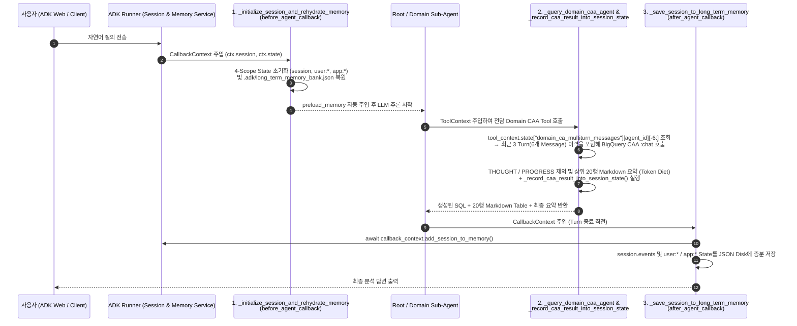

# [Code Walkthrough Guide] Root Agent 구성 및 ADK `Session` / `Memory` API 상세 Reference

본 문서는 Repository 내 Python Source Code 중 **Root Agent 및 3개 Domain Sub-Agent를 구성하는 핵심 File**의 구조와, **Google ADK 표준 `Session` 및 `Memory`를 조작하기 위해 호출하는 Library, Class, 내부 Function**을 Line 단위로 상세히 안내합니다 (`[확인됨 / Verified: bq_caa_3domain_multi_agent/agent.py]`).

---

## 1. Repository 내 Python File별 역할 및 Root Agent 구성 구조

Google ADK(`adk web`)는 하위 Directory 하나당 하나의 독립된 Agent Application으로 인식하며, 각 Directory 내부의 `agent.py`에 선언된 `root_agent` Variable을 Entrypoint로 Load합니다 (`[확인됨 / Verified: Google ADK Loader Convention]`). 본 Repository는 공식 Integration Pattern을 상호 비교하고 실무 최적화 아키텍처를 검증할 수 있도록 핵심 Multi-Agent Package와 보조 Single-Agent Package, 그리고 Backend Provisioning Script로 분리되어 있습니다.

| 구분 | Python File 경로 | ADK Web Dropdown 명칭 | 핵심 역할 및 Architecture 특징 |
| :--- | :--- | :--- | :--- |
| **Main 실습 Package** | **[`bq_caa_3domain_multi_agent/agent.py`](../bq_caa_3domain_multi_agent/agent.py)** | `bq_caa_3domain_multi_agent` | **Root Router Agent + 3개 Domain BQ CAA Sub-Agents + 4-Scope `Session.state` + `MemoryService` Long-Term Memory Architecture**가 통합 구현된 핵심 File |
| **Backend Provisioning** | **[`provision_bq_caa_demo.py`](../provision_bq_caa_demo.py)** | *(CLI 실행 Script)* | ADK Agent가 호출할 Google Cloud Backend의 **BigQuery Conversational Analytics(CAA) Data Agent 6종**을 GDA `v1` REST API로 생성 및 Update |
| **Data 준비 Script** | **[`scripts/01_prepare_bigquery_data.py`](../scripts/01_prepare_bigquery_data.py)** | *(CLI 실행 Script)* | `bigquery-public-data.thelook_ecommerce` Table을 사용자 Project(`<PROJECT_ID>.thelook_ecommerce_agent`, 기본 Region `US`)로 고속 CTAS 복제 후 Scenario Data Seeding |
| **보조 Demo 1 (Toolset 비교)** | **[`bq_caa_toolset_agent/agent.py`](../bq_caa_toolset_agent/agent.py)** | `bq_caa_toolset_agent` | Governance 미적용(`Baseline`) vs. Governance 적용(`Governed`) CAA Agent의 SQL 생성 정확도 차이를 비교 시연하는 Single Agent |
| **보조 Demo 2 (Streaming)** | **[`bq_caa_streaming_agent/agent.py`](../bq_caa_streaming_agent/agent.py)** | `bq_caa_streaming_agent` | LLM Router를 거치지 않고 Python `BaseAgent`에서 직접 BigQuery CAA Streaming API를 호출하는 Custom Streaming Sub-Agent Reference 구현체 |

---

## 2. Main File (`bq_caa_3domain_multi_agent/agent.py`) Code Map

[`bq_caa_3domain_multi_agent/agent.py`](../bq_caa_3domain_multi_agent/agent.py) (총 1,132 Lines)는 상단에서부터 환경 설정 및 SSL 초기화, 영속 Memory Store 유틸리티, ADK Lifecycle Callback, BigQuery CAA Stateless `:chat` 호출 및 4-Scope State 기록 함수, 사용자 Memory 관리 Tool, 3개 Domain Sub-Agent 정의, 그리고 최하단의 `root_agent` 선언 순서로 구성되어 있습니다. 각 핵심 Symbol의 정확한 Line 범위와 역할은 아래 표와 같습니다.

| 구성 요소 | Code Symbol (Variable / Function명) | Line 범위 | 상세 역할 및 최적화 설계 포인트 |
| :--- | :--- | :--- | :--- |
| **Root Agent 정의** | `root_agent` (`thelook_enterprise_root_router`) | [`L1077–L1132`](../bq_caa_3domain_multi_agent/agent.py#L1077-L1132) | 사용자 질의를 분석하여 **단일 Domain(`transfer_to_agent`)** 또는 **복합 Domain(`run_cross_domain_caa_analysis`)**으로 Routing하고, Session/Memory Callback 및 관리 Tool을 총괄하는 최상위 `LlmAgent` |
| **Sub-Agent 1 (Customer/Marketing)** | `customer_marketing_subagent` | [`L970–L1002`](../bq_caa_3domain_multi_agent/agent.py#L970-L1002) | `users`, `orders`, `events`, `order_items` Table만 격리 조회하는 마케팅 Domain 전문 `LlmAgent` (정적 `ask_customer_marketing_caa` Tool만 Binding하여 Metadata 탐색 Overhead 제거) |
| **Sub-Agent 2 (Product/Profitability)** | `product_profitability_subagent` | [`L1004–L1036`](../bq_caa_3domain_multi_agent/agent.py#L1004-L1036) | `products`, `order_items`, `orders` Table만 격리 조회하여 순매출·마진율·환불률을 계산하는 수익성 전문 `LlmAgent` (`ask_product_profitability_caa` 전용 Binding) |
| **Sub-Agent 3 (Supply Chain/Logistics)** | `supply_chain_logistics_subagent` | [`L1038–L1071`](../bq_caa_3domain_multi_agent/agent.py#L1038-L1071) | `distribution_centers`, `inventory_items`, `order_items`, `orders`, `products` Table만 격리 조회하여 물류센터 병목·미판매 재고를 분석하는 물류 전문 `LlmAgent` (`ask_supply_chain_logistics_caa` 전용 Binding) |
| **병렬 복합 분석 Tool** | `run_cross_domain_caa_analysis` | [`L868–L954`](../bq_caa_3domain_multi_agent/agent.py#L868-L954) | 2개 이상의 Domain이 결합된 복합 질의일 때 메인 Thread에서 추출한 `multiturn_snapshot`(`[-6:]`)을 `ThreadPoolExecutor(max_workers=3)`에 전달해 3개 BQ CAA를 동시 병렬 호출하는 Root Agent 전용 Tool |
| **Domain별 CAA 호출 Tool** | `_query_domain_caa_agent`<br/>`ask_customer_marketing_caa`<br/>`ask_product_profitability_caa`<br/>`ask_supply_chain_logistics_caa` | [`L401–L523`](../bq_caa_3domain_multi_agent/agent.py#L401-L523)<br/>[`L715–L745`](../bq_caa_3domain_multi_agent/agent.py#L715-L745)<br/>[`L747–L777`](../bq_caa_3domain_multi_agent/agent.py#L747-L777)<br/>[`L779–L805`](../bq_caa_3domain_multi_agent/agent.py#L779-L805) | BigQuery GDA `v1` `:chat` REST API(`DataAgentContext`, 필요 권한: `roles/geminidataanalytics.dataAgentUser`)를 호출하여 `THOUGHT`/`PROGRESS`를 제외한 최종 응답과 20행 Markdown 요약 표를 생성하고 결과를 `Session.state`에 기록 |
| **Session & Memory Callback** | `_initialize_session_and_rehydrate_memory`<br/>`_save_session_to_long_term_memory` | [`L182–L225`](../bq_caa_3domain_multi_agent/agent.py#L182-L225)<br/>[`L227–L299`](../bq_caa_3domain_multi_agent/agent.py#L227-L299) | 매 Turn 시작 시 `Session.state`(`app:`, `user:`, `session`, `temp:`) 초기화 및 Long-Term Memory 복원(`before_agent_callback`), 매 Turn 종료 시 `MemoryService` Indexing 및 Disk 영속화(`after_agent_callback`) |

---

## 3. Session 및 Memory 제어를 위해 호출하는 ADK 표준 Library

ADK에서 Agent의 대화 상태(`Session`)와 장기 기억(`Memory`)을 제어할 때는 전역 변수를 직접 참조하지 않고, ADK Runtime이 Lifecycle Callback과 Tool Function에 자동 주입하는 Context 객체를 통해 접근합니다. [`bq_caa_3domain_multi_agent/agent.py`](../bq_caa_3domain_multi_agent/agent.py) 상단([`L36–L42`](../bq_caa_3domain_multi_agent/agent.py#L36-L42))에서 Import하는 ADK 표준 Module은 다음과 같습니다.

```python
from google.adk.agents import LlmAgent
from google.adk.agents.callback_context import CallbackContext   # Lifecycle Callback에서 Session/State/Memory 접근
from google.adk.events import Event                              # Session 대화/Tool 실행 Event Object
from google.adk.tools import load_memory, preload_memory         # ADK 내장 Long-Term Memory 검색/주입 Tool
from google.adk.tools.tool_context import ToolContext            # Tool Function 내부에서 Session/State/Memory 접근
```

각 Class와 Tool이 제공하는 핵심 Property 및 Method의 동작 방식은 아래 표와 같습니다 (`[확인됨 / Verified: google-adk==2.7.1 SDK]`).

| ADK Class / Module | 접근 Property 및 Method | 역할 및 Runtime 동작 방식 |
| :--- | :--- | :--- |
| **`CallbackContext`**<br/>(`google.adk.agents.callback_context`) | • `callback_context.session`<br/>• `callback_context.state`<br/>• `callback_context.user_id`<br/>• `await callback_context.add_session_to_memory()` | Agent 실행 전후 Callback(`before_agent_callback`, `after_agent_callback`)의 첫 번째 인자로 자동 주입됩니다.<br/>• `session`: 현재 활성 `Session` Object (`id`, `app_name`, `events` List 보유)<br/>• `state`: 4-Scope State Dictionary (`temp:`, `session`, `user:`, `app:`) Read/Write 지원<br/>• `add_session_to_memory()`: 현재 Session의 Event 이력을 `MemoryService`에 즉시 Indexing |
| **`ToolContext`**<br/>(`google.adk.tools.tool_context`) | • `tool_context.session`<br/>• `tool_context.state`<br/>• `tool_context.user_id`<br/>• `await tool_context.search_memory(query)` | Agent가 호출하는 Python Tool Function에 `tool_context: ToolContext` 시그니처를 선언하면 Runtime이 자동 주입합니다.<br/>• BigQuery CAA Tool 실행 시 이전 Turn 대화 이력(`domain_ca_multiturn_messages`)을 읽고, 실행된 SQL과 결과 Row를 `tool_context.state`에 기록합니다. |
| **`Event`**<br/>(`google.adk.events`) | • `session.events`<br/>• `Event(author=..., content=...)` | Session 내에서 오간 사용자 질의, Agent 응답, Tool 호출 및 반환 기록을 담는 불변(Immutable) 단위의 표준 Event Object입니다. |
| **`preload_memory`**, **`load_memory`**<br/>(`google.adk.tools`) | • `tools=[preload_memory, load_memory, ...]` | • `preload_memory`: 매 Turn LLM 호출 직전에 현재 질문과 연관된 Long-Term Memory를 `<PAST_CONVERSATIONS>` Block으로 System Prompt에 자동 주입<br/>• `load_memory`: LLM이 판단하여 과거 Session 기억을 능동적으로 검색할 때 호출하는 Tool |

> [!NOTE]
> **`Runner`와 `SessionService` / `MemoryService`의 자동 Binding 원리**: `adk web` CLI를 실행하면 ADK Runtime(`Runner`)이 Background에서 기본 `InMemorySessionService`와 `InMemoryMemoryService` 인스턴스를 생성하여 `CallbackContext` 및 `ToolContext`에 연결합니다. 만약 자체 FastAPI Server나 Cloud Run 환경에서 직접 실행할 때는 `from google.adk.sessions import InMemorySessionService, VertexAiSessionService` 및 `from google.adk.memory import InMemoryMemoryService, VertexAiMemoryBankService`를 Import하여 `Runner(agent=root_agent, session_service=..., memory_service=...)`에 명시적으로 주입할 수 있습니다 (`[확인됨 / Verified: ADK Runner API]`).

---

## 4. Session 및 Memory를 조작하는 5대 핵심 Function 상세 분석

[`bq_caa_3domain_multi_agent/agent.py`](../bq_caa_3domain_multi_agent/agent.py) 내부에서 ADK Context 객체를 받아 실제로 4단계 State Scope와 Long-Term Memory를 제어하는 핵심 함수는 총 5개입니다. 한 번의 질의응답 Turn이 시작되고 종료될 때 이 함수들이 호출되는 순서와 데이터 흐름은 아래 Sequence Diagram과 같습니다.



### 4.1 Session 초기화 및 Memory 복원 Callback: `_initialize_session_and_rehydrate_memory` ([`L182–L225`](../bq_caa_3domain_multi_agent/agent.py#L182-L225))
이 함수는 `root_agent`와 3개 Sub-Agent의 `before_agent_callback` Parameter에 공통으로 등록되어([`L1000, L1034, L1069, L1130`](../bq_caa_3domain_multi_agent/agent.py#L1000)), 매 Turn LLM이 호출되기 직전에 실행됩니다.

```python
state = callback_context.state
session = callback_context.session
user_id = callback_context.user_id or "default_user"
```

내부적으로는 네 가지 초기화 작업을 수행합니다. 첫째, 새 Session이 시작된 경우(`"session_started_at" not in state`) 현재 Session 동안 유지될 `session_turn_count`, `active_domain`, `domain_query_history`, `domain_ca_multiturn_messages` 변수를 초기화합니다([`L197–L202`](../bq_caa_3domain_multi_agent/agent.py#L197-L202)). 둘째, 동일 사용자의 모든 Session 간에 공유되는 `user:profile`, `user:preferred_kpis`, `user:pinned_insights`를 Local JSON Store에서 읽어 복원함으로써 사용자가 `+ New Session` 버튼을 눌러 새 채팅창을 열더라도 직무와 관심 부서 설정이 즉시 적용되도록 보장합니다([`L205–L214`](../bq_caa_3domain_multi_agent/agent.py#L205-L214)). 셋째, Application 전역 통계인 `app:total_caa_queries_executed`를 복원합니다([`L217–L220`](../bq_caa_3domain_multi_agent/agent.py#L217-L220)). 넷째, `_sync_store_into_adk_memory_service`를 호출하여 Disk에 저장된 과거 대화 기록을 ADK `MemoryService`에 재주입합니다([`L223–L224`](../bq_caa_3domain_multi_agent/agent.py#L223-L224)).

### 4.2 BigQuery CAA 실행 결과의 4-Scope State 기록: `_record_caa_result_into_session_state` ([`L334–L398`](../bq_caa_3domain_multi_agent/agent.py#L334-L398))
`_query_domain_caa_agent`([`L401–L523`](../bq_caa_3domain_multi_agent/agent.py#L401-L523))가 BigQuery CAA `:chat` API를 호출하여 응답 Stream 파싱을 마치면, `tool_context.state`를 인자로 넘겨 이 함수를 호출합니다([`L499`](../bq_caa_3domain_multi_agent/agent.py#L499)).

먼저 **Invocation Scope(`temp:*`)**에는 현재 Turn 내에서만 참조할 원본 SQL과 결과 Row를 기록합니다([`L348–L352`](../bq_caa_3domain_multi_agent/agent.py#L348-L352)).

```python
state["temp:last_caa_domain"] = domain_label
state["temp:last_caa_sql"] = generated_sql
state["temp:last_caa_row_count"] = len(rows)
state["temp:last_caa_rows"] = rows[:20]
```

`temp:` 접두사가 붙은 변수는 현재 Turn이 끝나면 ADK Runtime에 의해 자동 폐기되므로 영속 Session DB가 대량 데이터로 비대화되는 것을 막아줍니다. 아울러 다음 Turn의 LLM Prompt가 비대화되는 것을 방지하기 위해, `_query_domain_caa_agent`는 `textType in ("THOUGHT", "PROGRESS")`인 내부 추론 텍스트를 응답에서 제외([`L483`](../bq_caa_3domain_multi_agent/agent.py#L483))하고 결과 데이터는 최대 20행의 Markdown 표(`_format_markdown_table(rows, max_rows=20)`, [`L495`](../bq_caa_3domain_multi_agent/agent.py#L495))로만 요약하여 반환합니다.

다음으로 **Session Scope(`session`)**에는 전체 Domain 공통 이력인 `domain_query_history`([`L359–L371`](../bq_caa_3domain_multi_agent/agent.py#L359-L371))와 함께, 각 Domain CAA Agent별 Multi-Turn 대화 배열인 `domain_ca_multiturn_messages`를 최근 3 Turn(6개 Message: `userMessage` + `systemMessage` 쌍)으로 슬라이싱하여 저장합니다([`L374–L380`](../bq_caa_3domain_multi_agent/agent.py#L374-L380)).

```python
multiturn_map = dict(state.get("domain_ca_multiturn_messages", {}))
agent_msgs = list(multiturn_map.get(agent_id, []))
agent_msgs.append({"userMessage": {"text": query}})
agent_msgs.append({"systemMessage": {"text": {"parts": [sys_summary[:1000]]}}})
multiturn_map[agent_id] = agent_msgs[-6:]  # Keep last 3 turns (6 messages)
state["domain_ca_multiturn_messages"] = multiturn_map
```

이후 동일 Domain에서 후속 질문이 들어오면 `_query_domain_caa_agent`([`L416–L420`](../bq_caa_3domain_multi_agent/agent.py#L416-L420))가 `multiturn_map[agent_id][-6:]`를 꺼내어 `:chat` 요청의 `messages` 필드에 주입하므로, Stateless `DataAgentContext` 호출에서도 최근 3 Turn의 문맥이 정확히 유지되면서 Input Token 상한선이 일정하게 통제됩니다.

### 4.3 Turn 종료 후 Long-Term Memory 영속화 Callback: `_save_session_to_long_term_memory` ([`L227–L299`](../bq_caa_3domain_multi_agent/agent.py#L227-L299))
`root_agent` 및 3개 Sub-Agent의 `after_agent_callback`에 등록된 이 함수는 매 Turn 응답 생성이 완료된 직후 실행됩니다([`L1001, L1035, L1070, L1131`](../bq_caa_3domain_multi_agent/agent.py#L1001)).

```python
# 1. Native ADK Memory Object indexing
await callback_context.add_session_to_memory()
```

위 표준 API 호출을 통해 현재 `callback_context.session`의 대화 Event(`session.events`)가 ADK `MemoryService`에 즉시 Indexing되며, 이어서 `session.events`와 `user:*` / `app:*` State가 Local JSON File(`.adk/long_term_memory_bank.json`)에 병합 저장됩니다([`L243–L295`](../bq_caa_3domain_multi_agent/agent.py#L243-L295)). 이를 통해 `adk web` 프로세스를 종료했다가 다시 기동하더라도 이전 Session의 분석 이력과 사용자 Profile이 유실되지 않습니다.

### 4.4 사용자 선호도 및 핵심 Insight 저장 Tool: `save_user_preference_and_memory` ([`L529–L619`](../bq_caa_3domain_multi_agent/agent.py#L529-L619))
사용자가 대화 도중 본인의 직책(`role`), 담당 부서(`focus_department`), 주요 마케팅 채널(`focus_channel`), 중점 관리 지표(`preferred_kpis_csv`), 또는 향후 Session에서도 기억해야 할 분석 결론(`key_insight_to_remember`)을 언급하면 LLM이 이 Tool을 호출합니다. 전달된 값은 `tool_context.state["user:profile"]`, `user:preferred_kpis`, `user:pinned_insights`에 즉시 반영되며, System Prompt 내 `_SHARED_SESSION_MEMORY_CONTEXT`([`L957–L964`](../bq_caa_3domain_multi_agent/agent.py#L957-L964))의 `{user:profile?}` Template 변수를 통해 모든 Sub-Agent의 추론 Context에 자동 주입됩니다.

### 4.5 Session 및 Memory 상태 실시간 진단 Tool: `inspect_session_and_memory_status` ([`L622–L709`](../bq_caa_3domain_multi_agent/agent.py#L622-L709))
사용자가 현재 Session의 내부 상태나 Long-Term Memory 저장 내역을 확인하고 싶을 때 호출되는 진단용 Tool입니다. 내부적으로 `tool_context.session.id`, `len(tool_context.session.events)`, 4단계 State Scope(`temp:*`, `session`, `user:*`, `app:*`)의 실시간 Snapshot, Domain별 Multi-Turn Message 보유 개수(`[-6:]` 기준), 그리고 `await tool_context.search_memory(memory_search_query)`([`L649`](../bq_caa_3domain_multi_agent/agent.py#L649))를 통해 검색된 과거 Session의 기억 항목을 구조화된 Dictionary로 반환합니다.
