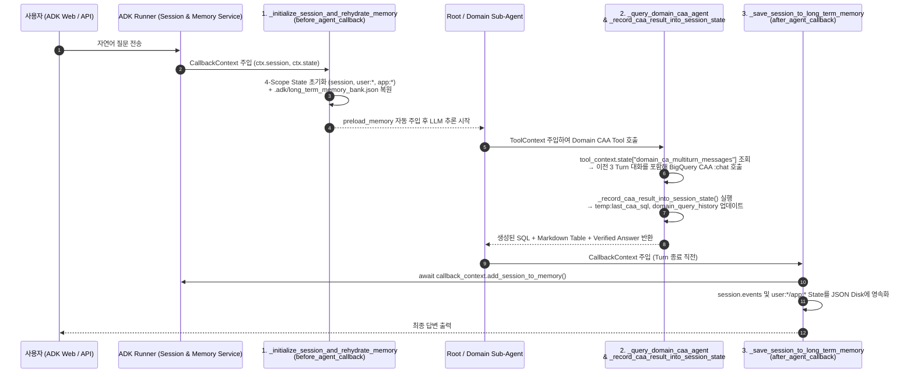

# [Code Walkthrough Guide] Root Agent 구성 및 ADK `Session` / `Memory` API 상세 Reference

본 문서는 Repository 내 Python Source Code 중 **Root Agent 및 3개 Domain Sub-Agent를 구성하는 핵심 File**의 구조와, **Google ADK 표준 `Session` 및 `Memory`를 조작하기 위해 호출하는 Library·Class·내부 Function**을 Line 단위로 상세히 안내합니다.

---

## 1. Repository 내 `.py` File별 역할 및 Root Agent 구성 File

Google ADK(`adk web`)는 **하위 Folder 하나당 하나의 독립된 Agent Application**으로 인식하며, 각 Folder의 `agent.py` 내부에 선언된 `root_agent` Variable을 Entrypoint로 Load합니다 (`[확인됨 / Verified: ADK Loader Convention]`).

| 구분 | Python File 경로 | ADK Web Dropdown 이름 | 핵심 역할 및 설명 |
| :--- | :--- | :--- | :--- |
| **★ Main 실습 File** | **[`bq_caa_3domain_multi_agent/agent.py`](../bq_caa_3domain_multi_agent/agent.py)** | `bq_caa_3domain_multi_agent` | **Root Router Agent + 3개 Domain BQ CAA Sub-Agents + 4-Scope `Session.state` + `MemoryService` Long-Term Memory Architecture**가 모두 구현된 핵심 File |
| **Backend Provisioning** | **[`provision_bq_caa_demo.py`](../provision_bq_caa_demo.py)** | *(CLI 실행 Script)* | ADK Agent가 호출할 Google Cloud Backend의 **BigQuery Conversational Analytics(CAA) Data Agent 6종**을 GDA v1 REST API로 생성·Update |
| **Data 준비 Script** | **[`scripts/01_prepare_bigquery_data.py`](../scripts/01_prepare_bigquery_data.py)** | *(CLI 실행 Script)* | `bigquery-public-data.thelook_ecommerce` Table을 사용자 Project(`<PROJECT_ID>.thelook_ecommerce_agent`, 기본 Region `US`)로 고속 CTAS 복제 후 Scenario Data Seeding |
| **보조 Demo 1 (단일 비교)** | **[`bq_caa_toolset_agent/agent.py`](../bq_caa_toolset_agent/agent.py)** | `bq_caa_toolset_agent` | Governance 미적용(`Baseline`) vs. Governance 적용(`Governed`) CAA Agent의 SQL 정확도 차이를 비교 시연하는 Single Agent |
| **보조 Demo 2 (Streaming)** | **[`bq_caa_streaming_agent/agent.py`](../bq_caa_streaming_agent/agent.py)** | `bq_caa_streaming_agent` | LLM Router를 거치지 않고 Python `BaseAgent`에서 직접 BigQuery CAA Streaming API를 호출하는 Architecture 비교용 Reference 구현체 |

---

## 2. Main File(`bq_caa_3domain_multi_agent/agent.py`) Code Map

[`bq_caa_3domain_multi_agent/agent.py`](../bq_caa_3domain_multi_agent/agent.py) (총 1,119 Lines) 내부에서 Root Agent와 3개 Sub-Agent를 구성하는 핵심 Symbol 및 Line 범위는 다음과 같습니다:

| 구성 요소 | Code Symbol (Variable/Function명) | Line 범위 | 상세 역할 |
| :--- | :--- | :--- | :--- |
| **Root Agent 정의** | `root_agent` (`thelook_enterprise_root_router`) | `L1064–L1119` | 사용자 질의를 분석하여 **단일 Domain(`transfer_to_agent`)** 또는 **복합 Domain(`run_cross_domain_caa_analysis`)**으로 Routing하고, Session/Memory Callback 및 Tool을 총괄하는 최상위 `LlmAgent` |
| **Sub-Agent 1 (사용자/마케팅)** | `customer_marketing_subagent` | `L954–L987` | `users`, `orders`, `events`, `order_items` Table만 격리 조회하는 사용자·마케팅 Domain 전문 `LlmAgent` |
| **Sub-Agent 2 (상품/수익성)** | `product_profitability_subagent` | `L989–L1022` | `products`, `order_items`, `orders` Table만 격리 조회하여 순매출·마진·반품률을 계산하는 수익성 전문 `LlmAgent` |
| **Sub-Agent 3 (물류/공급망)** | `supply_chain_logistics_subagent` | `L1024–L1058` | `distribution_centers`, `inventory_items`, `order_items`, `orders`, `products` Table만 격리 조회하여 물류센터 병목·재고 체류를 분석하는 물류 전문 `LlmAgent` |
| **병렬 복합 분석 Tool** | `run_cross_domain_caa_analysis` | `L867–L938` | 2개 이상의 Domain이 결합된 질문일 때 `ThreadPoolExecutor(max_workers=3)`로 3개 BQ CAA를 동시 호출하는 Root Agent 전용 Tool |
| **Domain별 CAA 호출 Tool** | `_query_domain_caa_agent`<br/>`ask_customer_marketing_caa`<br/>`ask_product_profitability_caa`<br/>`ask_supply_chain_logistics_caa` | `L401–L521`<br/>`L714–L756`<br/>`L768–L810`<br/>`L822–L864` | BigQuery GDA `:chat` REST API를 호출해 Golden SQL / Verified Answer를 받아오고 실행 결과를 `Session.state`에 자동 누적 |
| **Session & Memory Callback** | `_initialize_session_and_rehydrate_memory`<br/>`_save_session_to_long_term_memory` | `L182–L225`<br/>`L227–L299` | 매 Turn 시작 시 `Session.state`(`app:`, `user:`, `session`, `temp:`) 초기화 + Long-Term Memory 복원(`before_agent_callback`), 매 Turn 종료 시 `MemoryService` Indexing 및 Disk 영속화(`after_agent_callback`) |

---

## 3. Session 및 Memory 사용을 위해 호출하는 ADK 표준 Library

[`bq_caa_3domain_multi_agent/agent.py`](../bq_caa_3domain_multi_agent/agent.py) 상단(`L36–L43`)에서 Import하는 Google ADK 표준 Module은 다음과 같습니다:

```python
from google.adk.agents import LlmAgent
from google.adk.agents.callback_context import CallbackContext   # Lifecycle Callback에서 Session/State/Memory 접근
from google.adk.events import Event                              # Session 대화/Tool 실행 Event Object
from google.adk.tools import load_memory, preload_memory         # ADK 내장 Long-Term Memory 검색/주입 Tool
from google.adk.tools.tool_context import ToolContext            # Tool Function 내부에서 Session/State/Memory 접근
```

### 3.1 ADK Class별 제공 Property 및 Method Reference

| ADK Class / Module | 접근 Property 및 Method | 역할 및 동작 방식 |
| :--- | :--- | :--- |
| **`CallbackContext`**<br/>(`google.adk.agents.callback_context`) | • `callback_context.session`<br/>• `callback_context.state`<br/>• `callback_context.user_id`<br/>• `await callback_context.add_session_to_memory()` | Agent 실행 전/후 Callback(`before_agent_callback`, `after_agent_callback`)에 자동 주입됩니다.<br/>• `session`: 현재 `Session` Object(`id`, `app_name`, `events` List 보유)<br/>• `state`: 4-Scope State Dictionary(`temp:`, `session`, `user:`, `app:`) Read/Write<br/>• `add_session_to_memory()`: 현재 Session을 `MemoryService`에 즉시 Indexing |
| **`ToolContext`**<br/>(`google.adk.tools.tool_context`) | • `tool_context.session`<br/>• `tool_context.state`<br/>• `tool_context.user_id`<br/>• `await tool_context.search_memory(query)` | Agent가 호출하는 모든 Python Tool Function의 Argument로 자동 주입됩니다.<br/>• BigQuery CAA Tool 실행 시 이전 Turn 대화 이력(`domain_ca_multiturn_messages`)을 읽고, 실행된 SQL/결과 Row를 `tool_context.state`에 기록합니다. |
| **`Event`**<br/>(`google.adk.events`) | • `session.events`<br/>• `Event(author=..., content=...)` | Session 내에서 오간 사용자 질문, Agent 답변, Tool 호출 기록을 담는 표준 Event Object입니다. |
| **`preload_memory`**, **`load_memory`**<br/>(`google.adk.tools`) | • `tools=[preload_memory, load_memory, ...]` | • `preload_memory`: 매 Turn LLM 호출 직전에 관련 Long-Term Memory를 `<PAST_CONVERSATIONS>` Block으로 System Prompt에 자동 주입<br/>• `load_memory`: Agent가 필요할 때 능동적으로 과거 Session Memory를 검색 |

> 💡 **참고 (`Runner` & `SessionService` 자동 Binding)**:
> - `adk web` 실행 시 ADK Framework Runtime(`Runner`)이 Background에서 기본 `InMemorySessionService`와 `InMemoryMemoryService`를 자동 생성하여 `CallbackContext`와 `ToolContext`에 Binding해 줍니다.
> - Python Script나 자체 FastAPI Server에서 직접 실행할 때는 `from google.adk.sessions import InMemorySessionService, VertexAiSessionService` 및 `from google.adk.memory import InMemoryMemoryService, VertexAiMemoryBankService`를 Import하여 `Runner(agent=root_agent, session_service=..., memory_service=...)`에 전달합니다 (`[확인됨 / Verified: ADK Runner API]`).

---

## 4. Code 내에서 Session을 조작하는 5대 핵심 Function 상세 분석

[`bq_caa_3domain_multi_agent/agent.py`](../bq_caa_3domain_multi_agent/agent.py) 안에서 위 ADK Library를 받아 실제로 Session을 초기화·기록·조회하는 Function은 총 5개입니다.



### ① Session 초기화 Callback: `_initialize_session_and_rehydrate_memory(callback_context: CallbackContext)` (`L182–L225`)
- **연결 위치**: `root_agent` 및 3개 Sub-Agent의 `before_agent_callback` Parameter에 등록 (`L985, L1020, L1056, L1116`)
- **핵심 Code 및 동작**:
  ```python
  state = callback_context.state
  session = callback_context.session
  user_id = callback_context.user_id or "default_user"
  ```
  1. **Session-Scoped State 초기화 (`L197–L202`)**:
     - `state["session_started_at"]`, `state["session_turn_count"] = 0`, `state["active_domain"] = "Root Router"`, `state["domain_query_history"] = []`, `state["domain_ca_multiturn_messages"] = {}`
  2. **User-Scoped State 초기화 및 복원 (`L205–L214`)**:
     - `state["user:profile"]`, `state["user:preferred_kpis"]`, `state["user:pinned_insights"]`를 설정하여, 새 Session(`+ New Session`)을 열더라도 사용자의 직책/관심부서/선호 KPI가 유지되도록 보장합니다.
  3. **App-Scoped State 초기화 (`L217–L220`)**:
     - `state["app:total_caa_queries_executed"]`로 Application 전체 누적 CAA Query 실행 횟수를 추적합니다.

### ② BigQuery CAA 실행 결과의 Session 기록 Function: `_record_caa_result_into_session_state(...)` (`L334–L398`)
- **호출 위치**: `_query_domain_caa_agent(..., tool_context: ToolContext)` (`L401–L521`)가 BigQuery CAA `:chat` API로부터 응답을 받은 직후 `tool_context.state`를 넘겨 호출 (`L498`)
- **핵심 Code 및 동작**:
  1. **Turn 임시 State (`temp:*`) 저장 (`L348–L352`)**:
     ```python
     state["temp:last_caa_domain"] = domain_label
     state["temp:last_caa_sql"] = generated_sql
     state["temp:last_caa_row_count"] = len(rows)
     state["temp:last_caa_rows"] = rows[:20]
     ```
     현재 Turn 응답 생성에만 사용되고 Turn 종료 시 소멸되어 불필요한 Context 오염을 방지합니다.
  2. **Session 누적 Query History 저장 (`L355–L371`)**:
     `state["session_turn_count"]`를 `+1` 증가시키고, `state["domain_query_history"]` List에 생성된 SQL과 결과 요약을 누적합니다.
  3. **Domain별 Multi-Turn Context Chaining (`L374–L380`)**:
     ```python
     multiturn_map = dict(state.get("domain_ca_multiturn_messages", {}))
     agent_msgs = list(multiturn_map.get(agent_id, []))
     agent_msgs.append({"userMessage": {"text": query}})
     agent_msgs.append({"systemMessage": {"text": {"parts": [sys_summary[:1000]]}}})
     multiturn_map[agent_id] = agent_msgs[-6:]  # 최근 3 Turn(6개 Message) 유지
     state["domain_ca_multiturn_messages"] = multiturn_map
     ```
     이후 후속 Turn 질문(*"그 중에서 상위 3개만 보여줘"*)이 들어오면 `_query_domain_caa_agent` (`L413–L418`)가 `tool_context.state["domain_ca_multiturn_messages"][agent_id]`에서 이전 대화를 꺼내어 BigQuery CAA `:chat` API의 `messages` 배열에 함께 전송합니다.

### ③ Session 종료 후 Long-Term Memory 저장 Callback: `_save_session_to_long_term_memory(callback_context: CallbackContext)` (`L227–L299`)
- **연결 위치**: `root_agent` 및 3개 Sub-Agent의 `after_agent_callback` Parameter에 등록 (`L986, L1021, L1057, L1117`)
- **핵심 Code 및 동작**:
  ```python
  # 1. ADK 표준 Memory Object Indexing 호출
  await callback_context.add_session_to_memory()
  ```
  - 현재 `callback_context.session`의 Event(`session.events`)를 ADK `MemoryService`에 즉시 Indexing합니다.
  - 동시에 `callback_context.session.events`와 `user:*` / `app:*` State를 Local JSON File(`.adk/long_term_memory_bank.json`)에 병합 저장하여 `adk web` Server를 재시작하더라도 Long-Term Memory가 증발하지 않도록 보호합니다.

### ④ 사용자 선호도 및 Insight 저장 Tool: `save_user_preference_and_memory(..., tool_context: ToolContext)` (`L528–L619`)
- **역할**: 사용자가 대화 중 자신의 역할(`role`), 관심 부서(`focus_department`), 핵심 KPI(`preferred_kpis_csv`), 또는 기억해 둘 분석 결론(`key_insight_to_remember`)을 언급하면 LLM이 이 Tool을 호출해 `tool_context.state["user:profile"]`, `tool_context.state["user:preferred_kpis"]`, `tool_context.state["user:pinned_insights"]`에 즉시 기록합니다.

### ⑤ Session 및 Memory 상태 실시간 진단 Tool: `inspect_session_and_memory_status(..., tool_context: ToolContext)` (`L622–L709`)
- **역할**: 사용자가 *"현재 Session 상태와 Long-Term Memory 저장 내역을 점검해줘"*라고 요청하면 호출됩니다.
- **내부 동작**:
  - `tool_context.session.id`, `tool_context.session.app_name`, `len(tool_context.session.events)` 조회
  - `tool_context.state`의 4대 Scope(`temp:*`, `session`, `user:*`, `app:*`) 현재 값 Snapshot 반환
  - `await tool_context.search_memory(memory_search_query)` (`L649`)를 호출하여 ADK `MemoryService`에서 검색된 과거 Memory 목록을 함께 반환합니다.
