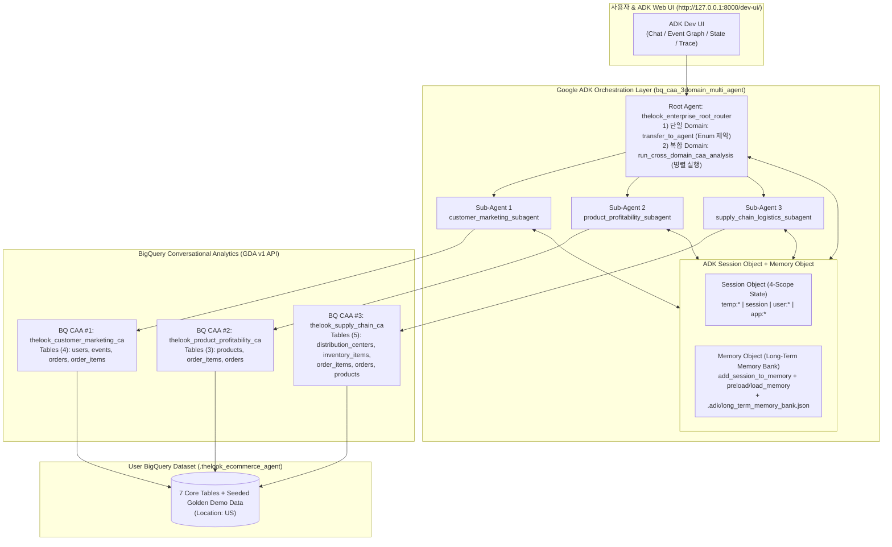

# [Qwiklabs Hands-on Lab] BigQuery Conversational Analytics (CAA) & Google ADK Multi-Agent 구축 실습 Guide
**(Domain-Scoped 3-SubAgent Routing + ADK `Session Object` & `Memory Object` Architecture Pattern)**

---

| 실습 항목 | 상세 정보 |
| :--- | :--- |
| **예상 소요 시간** | 약 45 ~ 60분 |
| **난이도** | 중급 ~ 고급 (Intermediate / Enterprise Architect) |
| **기본 Dataset** | `<USER_PROJECT_ID>.thelook_ecommerce_agent` (Region 기본값: `US`, `bigquery-public-data.thelook_ecommerce` 복제 + 3대 Domain Scenario Data 증강) |
| **핵심 기술 Stack** | Google ADK (`google-adk`), BigQuery Conversational Analytics API (`geminidataanalytics.googleapis.com/v1`), Vertex AI (`gemini-2.5-flash`), Terraform |

---

## Overview (실습 개요)

Google Cloud 공식 문서([Integration patterns for data agents](https://cloud.google.com/gemini/docs/conversational-analytics-api/integration-patterns))에서는 BQ CAA 연동 방식을 크게 **Direct API, ADK, MCP, A2A의 4대 통합 접근법(7개 세부 패턴)**으로 정의하고 있습니다. 본 Lab은 그중 엔터프라이즈 Multi-Agent 환경에서 Governance(Glossary/Verified Queries)가 보장되는 **핵심 패턴들(ADK `DataAgentToolset`, ADK `Custom Streaming Sub-Agent`, `Direct API Orchestrator`, `A2A`/`MCP`)**을 바탕으로, 실제 대규모 운영 시 발생하는 Token 비용 문제를 해결하기 위해 **ADK `Session`/`Memory` 기반의 경량 최적화 Best Practice**를 결합한 아키텍처를 실습합니다.

Enterprise 환경에서 자연어 기반 SQL 분석(NL2SQL) Agent를 구축할 때 가장 흔히 겪는 **3가지 실무 문제**는 다음과 같습니다:

1. **단일 거대 Agent의 Token 비용 폭증 및 오조인(Mis-Join) 문제**:
   - 수십 개의 Table과 모든 부서의 Business Glossary를 단 하나의 BigQuery CAA Agent에 몰아넣으면, 매 질문마다 불필요한 Schema와 규칙이 Prompt에 포함되어 입력 Token이 급증하고 유사 Column(`users.created_at` vs `orders.created_at` vs `inventory_items.created_at`) 간 오조인이 발생합니다.
2. **무이력 단발 호출(One-Shot Stateless) 시의 Multi-Turn 대화 Context 단절**:
   - 공식 Stateless API(`DataAgentContext`) 자체는 `messages` 배열에 이력을 담아 보내면 Multi-Turn이 가능하지만, ADK 기본 내장 `ask_data_agent`처럼 이력 체이닝 없이 현재 질문 1개만 단발성으로 전달하면 이전 질문에서 걸었던 조건(예: *"Women 부서 중에서"*)을 후속 질문(*"환불률이 가장 높은 브랜드는?"*)에서 잃어버리게 됩니다(반면 관리형 `ConversationReference`는 `1 Conversation = 1 Agent` 제약으로 도메인 전환 시 문맥이 단절됨).
3. **Session 종료 후 사용자 역할·선호 KPI 초기화 (Lack of Long-Term Memory)**:
   - 사용자가 새로운 채팅 Session(`+ New Session`)을 열 때마다 본인의 담당 부서, 직무 역할, 중점 관리 지표(KPI), 그리고 이전 Session에서 도출했던 핵심 Insight를 처음부터 다시 설명해야 합니다.

본 Hands-on Lab에서는 위 3가지 문제를 해결하는 **Multi-Agent Architecture Pattern**을 사용자의 GCP Project에 직접 구축하고 실습합니다:



### Objectives (학습 목표)
이 Lab을 완료하면 다음 작업을 수행하고 원리를 설명할 수 있습니다:
- **Task 1**: 사용자 GCP Project 정보 입력(`00_configure_customer_env.sh`) 및 Terraform/Script를 통한 BigQuery 환경 구성
- **Task 2**: `bigquery-public-data.thelook_ecommerce` 원본 복제(`thelook_ecommerce_agent`) 및 3대 Domain Demo Scenario용 Golden Data 추가 원리 이해
- **Task 3**: 단일 CAA Agent(Baseline vs Governed) 및 **3대 Domain 분리형 CAA Agent** Provisioning
- **Task 4**: **Root Agent → 3 BQ CAA Sub-Agents Routing Logic**(`transfer_to_agent`, Peer-to-Peer 전환, 병렬 Fan-out) 실습 및 Event Graph 확인
- **Task 5**: **ADK 표준 `Session Object`(4-Scope State) + `Memory Object`(Long-Term Memory)** Architecture 동작 확인 및 교차 Session(`+ New Session`) Memory 복원 실습

---

## Setup & Requirements (사전 준비 사항)

1. **필수 Tool 확인**:
   - Python `3.11` 이상
   - Google Cloud SDK (`gcloud`) 설치 및 본인 계정 Login
   - (선택) Terraform `1.5.0` 이상 (Terraform 대신 Python Script로도 100% 동일하게 구성 가능)
2. **Google Cloud Keyless ADC (Application Default Credentials) 인증**:
   사내 보안 정책상 `GOOGLE_API_KEY`(AI Studio Key)를 사용하지 않고, GCP IAM 기반의 **Keyless ADC 인증**을 사용합니다. Terminal에서 아래 Command를 실행하여 Login합니다:

```bash
gcloud auth login
gcloud auth application-default login
```

---

## Task 1. 사용자 GCP 환경 Variable 설정 및 Infrastructure 구성 (5분)

### 왜 이 단계가 필요한가요? (Why It Matters)
모든 사용자마다 GCP Project ID(`PROJECT_ID`), Dataset 이름(`BQ_DATASET_ID`), Region 정책이 다릅니다. 본 Repository는 Code 내 Hardcoding을 완전히 제거하고, 대화형 Script(`scripts/00_configure_customer_env.sh`)를 통해 입력받은 사용자 정보를 **Terraform Variable File(`terraform/terraform.tfvars`)**과 **5개 ADK Agent의 `.env` File**에 일괄 주입합니다.

### Step 1-1. 사용자 환경 설정 Wizard 실행
Repository Root Directory에서 아래 Command를 실행합니다:

```bash
chmod +x scripts/00_configure_customer_env.sh setup_mac_adk.sh run_adk_web.sh
./scripts/00_configure_customer_env.sh
```

Prompt가 나타나면 아래 기준에 맞춰 입력합니다 (Enter를 누르면 대괄호 안의 기본값이 적용됩니다):
1. **GCP Project ID**: 본인의 테스트/사용자 GCP Project ID 입력 (예: `my-enterprise-poc-project`)
2. **Target BigQuery Dataset Name**: 기본값 **`thelook_ecommerce_agent`** 권장 (Enter)
3. **BigQuery Dataset Location**: 기본값 **`US`** 권장 (Enter)
   - > 💡 **왜 기본 Region이 `US`인가요?**: 원본 Public Dataset(`bigquery-public-data.thelook_ecommerce`)이 `US` Multi-Region에 위치하므로, `US` Region에 Dataset을 생성하면 BigQuery In-Region `CREATE OR REPLACE TABLE ... AS SELECT` (CTAS) Query로 **단 15초 만에 7개 Table(약 335만 Row) 복제가 완료**됩니다. (만약 `asia-northeast3` 등 타 Region을 입력하면 Terraform이 자동으로 BigQuery Data Transfer Service `cross_region_copy`를 구성합니다.)
4. **Vertex AI Region**: 기본값 **`us-central1`** 권장 (Enter)

```bash
# 생성된 Environment Variable을 현재 Shell에 Load하고 ADC Quota Project를 지정합니다.
source customer_config.env
gcloud auth application-default set-quota-project "$GOOGLE_CLOUD_PROJECT"
```

---

## Task 2. `thelook_ecommerce_agent` Dataset 생성 및 Demo Scenario Data 추가 (5분)

### 왜 Demo Scenario Data를 추가로 생성하나요? (How It Works & Why It Matters)
`bigquery-public-data.thelook_ecommerce` 원본 Table만 복제할 경우 두 가지 문제가 있습니다:
1. **상대 시간 조건 Query 문제**: 사용자가 *"최근 30일 이내 가입한 신규 사용자"*이나 *"지난 달 주문 이력이 있는 우수(VIP) 사용자"*를 질문했을 때 `CURRENT_TIMESTAMP()` 기준으로 최신 Data가 부족할 수 있습니다.
2. **Domain별 이상징후(Anomaly) 시연 효과**: 사용자 Demo에서 명확한 Insight를 보여주려면 Domain별로 뚜렷한 Pattern이 존재해야 합니다.

따라서 `scripts/01_prepare_bigquery_data.py`는 다음 2단계를 순차 실행합니다:
- **`sql/01_clone_public_thelook.sql`**: `bigquery-public-data.thelook_ecommerce`의 7개 Table(`distribution_centers`, `events`, `inventory_items`, `order_items`, `orders`, `products`, `users`)을 `<PROJECT_ID>.thelook_ecommerce_agent`로 복제합니다.
- **`sql/02_seed_demo_scenarios.sql`**: 복제된 Table 위에 현재 시각(`CURRENT_TIMESTAMP()`) 기준의 **3대 Domain Golden Scenario Data**를 Idempotent하게 추가합니다:
  - **[Domain 1 Seed Data]**: 최근 30일 내 `Search` 및 `Email` 채널로 유입되어 $735 이상 구매한 **VIP 사용자 60명** 및 `Display` 채널의 **장바구니 이탈 Session 120건**
  - **[Domain 2 Seed Data]**: `Women` 부서 `Outerwear & Coats` 카테고리의 **고마진율(56.4%) 캐시미어 트렌치코트 20종** 및 특정 브랜드(`TheLook Atelier`)의 **집중 반품(`Returned`)/취소(`Cancelled`) 주문 180건**
  - **[Domain 3 Seed Data]**: `Chicago IL`(DC #2) 물류센터의 **평균 6일 배송 지연 병목 Data** 및 **미판매 재고(`sold_at IS NULL`) 220건**

### Step 2-1. Data 준비 실행 (Python Script 또는 Terraform 선택)

**[방법 A — Python Script로 즉시 실행 (권장, 약 25초 소요)]**:
```bash
python3 scripts/01_prepare_bigquery_data.py
```

**[방법 B — Terraform으로 API 활성화 + Dataset + CAA Agent 일괄 배포]**:
```bash
cd terraform
terraform init
terraform apply -auto-approve
cd ..
```

### 예상 출력 결과 (Expected Output)
```text
  ┌──────────────────────────┬──────────────┬───────────────────┐
  │ Table Name               │ Total Rows   │ Seeded Demo Rows  │
  ├──────────────────────────┼──────────────┼───────────────────┤
  │ distribution_centers     │           10 │                 0 │
  │ events                   │    2,426,192 │               120 │
  │ inventory_items          │      490,861 │               400 │
  │ order_items              │      181,776 │               180 │
  │ orders                   │      125,270 │               180 │
  │ products                 │       29,140 │                20 │
  │ users                    │      100,060 │                60 │
  └──────────────────────────┴──────────────┴───────────────────┘
✅ Dataset `<PROJECT_ID>.thelook_ecommerce_agent` is ready for BigQuery CAA & ADK Multi-Agent Lab!
```

### ✅ Check My Progress (Task 1 & 2 자가 진단)
```bash
python3 scripts/03_verify_lab_progress.py --task 1
python3 scripts/03_verify_lab_progress.py --task 2
```

---

## Task 3. Domain 분리형 BigQuery CAA Agent Provisioning (5분)

### 어떻게 동작하며 왜 필요한가요? (How It Works & Why It Matters)
`provision_bq_caa_demo.py`는 Gemini Data Analytics API(`geminidataanalytics.googleapis.com/v1/projects/{project}/locations/global/dataAgents`)를 호출하여 총 **6개의 CAA Data Agent**를 생성(또는 Update)합니다:

1. **Governance 전/후 비교용 Single Agent (2종 + 호환 Alias 1종)**:
   - `thelook_baseline_ca_agent`: 7개 Table만 연결하고 Business Glossary를 넣지 않은 순수 Schema Agent (Before Governance)
   - `thelook_governed_ca_agent`: 7개 Table + 10대 사내 표준 Business Glossary(VIP 사용자, 환불률, 마진율 등 SQL 수식)를 주입한 Agent (After Governance)
2. **Root + 3 Sub-Agents Multi-Agent용 Domain 특화 Agent (3종)**:
   - **`thelook_customer_marketing_ca`** (Sub-Agent 1 전담): `users`, `events`, `orders`, `order_items` **4개 Table만 연결** + 사용자/마케팅 Glossary
   - **`thelook_product_profitability_ca`** (Sub-Agent 2 전담): `products`, `order_items`, `orders` **3개 Table만 연결** + 상품/수익성/반품 Glossary
   - **`thelook_supply_chain_ca`** (Sub-Agent 3 전담): `distribution_centers`, `inventory_items`, `order_items`, `orders`, `products` **5개 Table만 연결** + 물류/재고/배송 Glossary

### Step 3-1. CAA Agent Provisioning Script 실행
(Task 2에서 Terraform `apply`를 실행했다면 이미 자동으로 실행되었습니다. 수동 실행 또는 Update 확인을 위해 아래 Command를 실행합니다.)

```bash
python3 provision_bq_caa_demo.py
```

### ✅ Check My Progress (Task 3 자가 진단)
```bash
python3 scripts/03_verify_lab_progress.py --task 3
```

---

## Task 4. Google ADK Web UI 구동 및 Root → 3 Sub-Agents Routing 실습 (15분)

### Root Agent가 3개 BQ CAA Sub-Agent를 Routing하는 원리 (Routing Deep Dive)
[`bq_caa_3domain_multi_agent/agent.py`](../bq_caa_3domain_multi_agent/agent.py)의 Root Agent(`thelook_enterprise_root_router`)는 질문이 들어오면 다음 **3가지 Routing Mechanism**으로 동작합니다:

1. **단일 Domain 질문 → ADK 내장 `transfer_to_agent` 위임**:
   - ADK의 `_AgentTransferLlmRequestProcessor`가 3개 Sub-Agent의 `name`과 `description`을 Prompt에 자동 주입하고, `TransferToAgentTool`이 JSON Schema `enum` 제약(`["customer_marketing_subagent", "product_profitability_subagent", "supply_chain_logistics_subagent"]`)을 걸어 Hallucination 호출을 차단합니다.
   - Root가 `transfer_to_agent`를 호출하면 **동일 Turn 내에서 즉시 해당 Sub-Agent가 실행**되며, 각 Sub-Agent는 오직 자신의 Domain CAA Tool(`ask_*_caa`)만 호출합니다.
2. **후속 질문의 Domain 전환 → Sub-Agent 간 수평 이관 (`Peer-to-Peer Transfer`)**:
   - Sub-Agent 1(사용자/마케팅)과 대화하던 중 사용자가 갑자기 물류 질문을 하면, ADK의 `_get_transfer_targets()`가 열어준 Peer Agent 경로를 통해 `customer_marketing_subagent` → `supply_chain_logistics_subagent`로 즉시 제어권이 이관됩니다.
3. **복합 Domain 질문 → `run_cross_domain_caa_analysis` 병렬 Fan-out**:
   - 한 질문에 2개 이상의 Domain이 포함된 경우 Root Agent가 질문을 Domain별 Sub-Query로 분해한 뒤 `ThreadPoolExecutor`로 **3개 Domain CAA API를 동시에 병렬 호출**하여 대기 시간을 단축하고 종합 Report를 작성합니다.

### Step 4-1. ADK 설치 및 Web UI 실행
Terminal에서 아래 원클릭 Script를 실행합니다 (Python 가상환경 `.venv` 생성, `google-adk` 설치, macOS/Linux SSL 인증서 Bundle 구성, `.env` 생성 후 `http://127.0.0.1:8000/dev-ui/`를 기동합니다):

```bash
./setup_mac_adk.sh "$GOOGLE_CLOUD_PROJECT" "$BQ_DATASET_ID"
```

Browser에서 **[http://127.0.0.1:8000/dev-ui/](http://127.0.0.1:8000/dev-ui/)**를 열고 좌측 상단 Agent 선택 Dropdown에서 **`bq_caa_3domain_multi_agent`**를 선택합니다.

### Step 4-2. 단계별 Routing Prompt 실습

1. **[Registry 확인 — Root Agent 직접 응답]**:
   ```text
   현재 구성된 3개 Sub-Agent와 각 BQ CAA Agent의 담당 Table 및 핵심 비즈니스 용어를 표로 보여줘
   ```
2. **[Domain 1 Routing — `customer_marketing_subagent`로 `transfer_to_agent`]**:
   ```text
   유입 경로(마케팅 채널)별로 VIP 사용자 수와 장바구니 포기율을 분석해줘
   ```
   - 좌측 **Event Graph** Tab을 클릭해 보세요: `thelook_enterprise_root_router` → `customer_marketing_subagent` → `ask_customer_marketing_caa` 호출 흐름이 시각적으로 표시됩니다.
3. **[Domain 2 수평 전환 — `customer_marketing_subagent` → `product_profitability_subagent`]**:
   ```text
   여성(Women) 의류 중에서 상품 마진율이 40% 이상인 제품들의 환불률(취소/반품 비율)을 브랜드별로 높은 순으로 상위 5개만 보여줘
   ```
   - 앞선 Task 2에서 Seed한 고마진 트렌치코트 브랜드(`TheLook Atelier`, `Nordic Luxe`)의 반품 Anomaly가 정확히 포착되는지 확인하세요.
4. **[Domain 3 수평 전환 — `product_profitability_subagent` → `supply_chain_logistics_subagent`]**:
   ```text
   물류 센터(DC)별 평균 배송 소요 시간(일)과 미판매 재고 원가 총액을 비교해줘
   ```
5. **[복합 Domain 병렬 실행 — `run_cross_domain_caa_analysis`]**:
   ```text
   유입 경로별 VIP 사용자 수, 상품 카테고리별 평균 마진율 상위 5개, 그리고 물류센터별 평균 배송 소요 시간을 한 번에 종합 분석해서 경영진 Report로 정리해줘
   ```

---

## Task 5. ADK `Session Object` + `Memory Object` (Long-Term Memory) 실습 (15분)

### 왜 ADK `Session Object` + `Memory Object` Architecture Pattern이 필요한가요?
일반적인 단발성 호출 Agent는 대화가 길어지거나 새 Session(`+ New Session`)을 열면 이전 Context를 모두 잃어버립니다. 본 Agent는 ADK의 **4단계 `Session.state` Scope**와 **`MemoryService` + Local 영속 Backup(`.adk/long_term_memory_bank.json`)**을 결합하여 다음을 보장합니다:

| 구분 | Scope / Component | 보존 범위 (Lifecycle) | 저장 Data 및 강화되는 기능 |
| :--- | :--- | :--- | :--- |
| **Session Object** | **`temp:*`** | 현재 Turn(Invocation)만 유지 | `temp:last_caa_sql`, `temp:last_caa_rows` — 방대한 조회 결과 Row를 동일 Turn 내 후속 처리에 전달한 뒤 Turn 종료 시 자동 소멸시켜 영속 Session DB 오염 방지 (다음 Turn LLM Prompt 오염 방지는 Tool 반환값의 20행 요약 및 `THOUGHT`/`PROGRESS` 제거로 달성) |
| | **`session` (무접두사)** | 현재 Session 내 모든 Turn 유지 | `domain_query_history`, `domain_ca_multiturn_messages[-6:]` — 동일 Domain 후속 질문 시 최근 3 Turn(6개 Message)을 CAA `:chat` API(`DataAgentContext`, 필요 권한: `roles/geminidataanalytics.dataAgentUser`)의 `messages` 배열에 자동 Chaining하고, 이종 Domain 간 전환 시에는 ADK Sub-Agent가 공유 `domain_query_history`를 참조해 완결형 질의(Standalone Query)로 재작성 |
| | **`user:*`** | **동일 사용자의 모든 Session 간 영속 유지** | `user:profile`(직무/관심부서/채널), `user:preferred_kpis`, `user:pinned_insights` — 새 Session을 열어도 사용자의 담당 부서와 중점 KPI가 System Prompt에 자동 주입됨 |
| | **`app:*`** | Application 전역 공유 | `app:total_caa_queries_executed` — 전체 누적 CAA Query 실행 횟수 집계 |
| **Memory Object** | **`after_agent_callback`** | 영구 보존 (Session 간 + Server 재시작 후) | 매 Turn 종료 시 `await callback_context.add_session_to_memory()`를 호출하여 `Session` Object를 `MemoryService`에 Indexing하고 `.adk/long_term_memory_bank.json`에 저장 |
| | **`preload_memory` & `load_memory`** | 매 Turn Prompt 생성 시 | 새 Session에서 질문할 때 과거 Session의 관련 분석 이력과 Insight를 검색하여 `<PAST_CONVERSATIONS>` Block으로 자동 주입 |

### Step 5-1. [Session #1] 사용자 Profile/KPI 저장 및 핵심 Insight 기억 실습
현재 열린 Session에서 아래 Prompt를 입력합니다:

```text
나는 MD 본부장이고 주로 Women 부서와 Search 채널을 담당해. 중점 관리 KPI는 상품 마진율, 환불률, VIP 사용자야. 그리고 'Women 부서 Outerwear & Coats 카테고리의 마진율이 50% 이상으로 가장 높지만 반품률 관리가 필요함'이라는 핵심 Insight도 Long-Term Memory에 함께 저장해줘.
```

- **확인 Point**: `save_user_preference_and_memory` Tool이 실행됩니다. ADK Web UI 우측 상단의 **`State` Tab**을 클릭하면 `user:profile`, `user:preferred_kpis`, `user:pinned_insights`가 실시간으로 등록된 것을 눈으로 확인할 수 있습니다.

### Step 5-2. [Session #2 — `+ New Session` 생성] 교차 Session Long-Term Memory 복원 검증
1. ADK Web UI 우측 상단의 **`+ New Session`** Button을 클릭하여 **완전히 새로운 빈 Session**을 생성합니다.
2. 새 Session에서 아무런 배경 설명 없이 아래와 같이 질문합니다:

```text
현재 내 Session 상태(4단계 State Scope)와 Long-Term Memory 상태를 점검해서 보여주고, 지난 Session에서 내가 어떤 직무/부서를 담당한다고 했고 어떤 핵심 Insight를 기억해 달라고 했는지 알려줘.
```

- **확인 Point**:
  - 새 Session임에도 `before_agent_callback`(`_initialize_session_and_rehydrate_memory`)과 `preload_memory` / `inspect_session_and_memory_status` Tool이 동작합니다.
  - `user:profile`(`MD 본부장`, `Women`, `Search`), `app:total_caa_queries_executed` 누적 횟수가 그대로 유지되며, `MemoryService`에서 지난 Session에 저장한 `Outerwear & Coats 마진율 및 반품률 Insight`를 정확히 찾아내어 브리핑합니다!

### ✅ Check My Progress (Task 4 & 5 전체 완료 자가 진단)
Terminal에서 아래 Command를 실행하여 모든 실습 과제가 정상 완료되었는지 최종 확인합니다:

```bash
python3 scripts/03_verify_lab_progress.py --all
```

---

## Congratulations! (실습 완료)
축하합니다! 사용자의 GCP Project에 `bigquery-public-data.thelook_ecommerce` 기반의 Demo Dataset(`thelook_ecommerce_agent`)을 구축하고, **Domain 분리형 3대 BigQuery CAA Agent**, **Root Agent 지능형 Routing**, 그리고 **ADK 표준 `Session Object` + `Memory Object` Architecture**까지 전 과정을 성공적으로 구현 및 검증하셨습니다.
