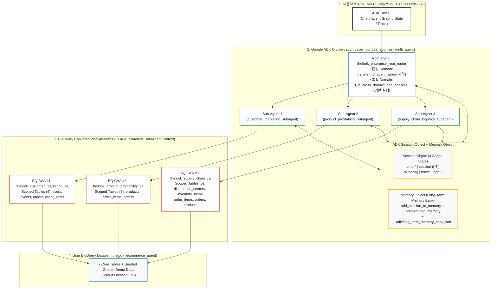

# [Qwiklabs Hands-on Lab] BigQuery Conversational Analytics (CAA) & Google ADK Multi-Agent 구축 실습 Guide
**(Domain-Scoped 3-SubAgent Routing + ADK `Session` & `Memory` 기반 Token 최적화 Architecture)**

---

| 실습 항목 | 상세 정보 |
| :--- | :--- |
| **예상 소요 시간** | 약 45 ~ 60분 |
| **난이도** | 중급 ~ 고급 (Intermediate / Enterprise Architect) |
| **기본 Dataset** | `<USER_PROJECT_ID>.thelook_ecommerce_agent` (Region 기본값: `US`, `bigquery-public-data.thelook_ecommerce` 복제 + 3대 Domain Scenario Data 증강) |
| **핵심 기술 Stack** | Google ADK (`google-adk`), BigQuery Conversational Analytics API (`geminidataanalytics.googleapis.com/v1`), Vertex AI (`gemini-2.5-flash`), Terraform |

---

## Overview (실습 개요)

Google Cloud 공식 문서인 [Integration patterns for data agents](https://cloud.google.com/gemini/docs/conversational-analytics-api/integration-patterns)와 [State management for data agents](https://cloud.google.com/gemini/docs/conversational-analytics-api/state-management)에서는 BigQuery Conversational Analytics API(이하 BQ CAA) 연동 방식을 크게 **Direct API, ADK, MCP, A2A의 4대 Integration Approach(총 7개 세부 Pattern)**와 **3가지 API Context Mode(`ConversationReference`, `DataAgentContext`, `InlineContext`)**로 정의하고 있습니다 (`[확인됨 / Verified: Google Cloud Official Documentation]`). 본 Hands-on Lab은 그중 Enterprise Multi-Agent 환경에서 Governance(Business Glossary 및 Verified Queries)가 보장되는 **핵심 Pattern들(ADK `DataAgentToolset`, ADK `Custom Streaming Sub-Agent`, `Direct API Orchestrator`, `A2A`/`MCP`)**을 바탕으로, 실제 대규모 운영 시 발생하는 Input Token 비용 폭증과 도메인 간 문맥 단절 문제를 해결하기 위해 **ADK `Session` 및 `Memory` 기반의 경량 최적화 Best Practice**를 결합한 아키텍처를 실습합니다.

Enterprise 환경에서 자연어 기반 SQL 분석(NL2SQL) Agent를 구축하고 운영할 때 직면하는 대표적인 세 가지 기술적 난제는 다음과 같습니다.

첫째, **단일 거대 Agent의 Input Token 급증 및 오조인(Mis-Join) 문제**입니다. 수십 개의 Table과 전사 부서의 Business Glossary를 단 하나의 BigQuery CAA Agent에 모두 연결하면, 매 질의마다 불필요한 Table Schema와 규칙이 내부 Prompt에 주입되어 호출당 과도한 Input Token이 소모되며, 유사한 이름의 Column(`users.created_at` vs. `orders.created_at` vs. `inventory_items.created_at`) 간 오조인 발생 확률이 높아집니다.

둘째, **무이력 단발 호출(One-Shot Stateless) 및 관리형 `ConversationReference`의 Multi-Agent 문맥 단절 문제**입니다. 공식 Stateless API(`DataAgentContext`) 자체는 Client가 `messages` 배열에 이전 대화 이력을 담아 전송하면 Multi-Turn 대화가 가능하지만, ADK 기본 내장 `ask_data_agent`처럼 이력 Chaining 없이 현재 질의 1개만 단발성으로 전달하면 직전 Turn에 설정한 필터 조건(예: *"Women 부서 중에서"*)을 후속 질의(*"환불률이 가장 높은 Brand는?"*)에서 상실하게 됩니다. 반대로 서버 관리형 Stateful Mode(`ConversationReference`)를 사용하면 `1 Conversation = 1 Data Agent` 고정 귀속 제약으로 인해 다른 Domain의 CAA Agent로 전환되는 순간 문맥이 끊어집니다.

셋째, **Session 종료 후 사용자 직무 및 선호 KPI 초기화(Lack of Long-Term Memory) 문제**입니다. 사용자가 새로운 채팅 Session(`+ New Session`)을 열거나 Web Server가 재시작될 때마다 본인의 담당 부서, 직무 역할, 중점 관리 지표(KPI), 그리고 이전 Session에서 도출했던 핵심 분석 Insight를 처음부터 다시 입력해야 합니다.

본 Hands-on Lab에서는 위 세 가지 문제를 해결하는 **Domain-Scoped Multi-Agent 및 4-Scope `Session`/`Memory` Architecture**를 사용자의 GCP Project에 직접 배포하고 단계별로 검증합니다 (`[확인됨 / Verified: bq_caa_3domain_multi_agent/agent.py]`).



### 학습 목표 (Objectives)
본 Lab을 완료하면 다음 다섯 가지 핵심 과제를 직접 수행하고 내부 동작 원리를 설명할 수 있습니다.
1. **Task 1**: 대화형 설정 Script(`00_configure_customer_env.sh`)를 통한 GCP Project 환경 구성 및 IAM 권한 이해
2. **Task 2**: `bigquery-public-data.thelook_ecommerce` 원본 고속 복제(`thelook_ecommerce_agent`) 및 3대 Domain Golden Scenario Data 증강
3. **Task 3**: 단일 CAA Agent(Baseline vs. Governed) 및 3대 Domain 분리형 CAA Agent(총 6종) Provisioning
4. **Task 4**: Root Agent → 3 BQ CAA Sub-Agents Routing(`transfer_to_agent`, Peer-to-Peer 전환, 병렬 Fan-out) 실습 및 Event Graph 검증
5. **Task 5**: ADK 표준 `Session Object`(4-Scope State) + `Memory Object`(Long-Term Memory) 동작 확인 및 교차 Session(`+ New Session`) 복원 검증

---

## 사전 준비 사항 (Setup & Requirements)

실습을 시작하기 전에 로컬 환경(MacBook 또는 Linux Cloudtop)에 Python `3.11` 이상과 Google Cloud SDK(`gcloud`)가 설치되어 있어야 합니다. 사내 보안 정책상 `GOOGLE_API_KEY`(Google AI Studio Key)는 사용하지 않으며, 모든 인증은 GCP IAM 기반의 **Keyless Application Default Credentials(ADC)**로 처리합니다. Terminal에서 아래 Command를 실행하여 GCP 계정에 로그인합니다.

```bash
gcloud auth login
gcloud auth application-default login
```

> [!IMPORTANT]
> **필요 IAM Role 안내**: 본 실습에서 생성된 Pre-configured Data Agent(`DataAgentContext`)를 호출하려면 실행 계정에 `roles/geminidataanalytics.dataAgentUser`(생성·수정 포함 시 `dataAgentCreator` 또는 `dataAgentOwner`)와 `roles/bigquery.user`, `roles/aiplatform.user` 권한이 필요합니다. (참고로 `roles/geminidataanalytics.dataAgentStatelessUser`는 사전 등록된 Agent 없이 `InlineContext`를 호출할 때만 사용되는 권한입니다.) (`[확인됨 / Verified: IAM roles for Conversational Analytics]`)

---

## Task 1. 사용자 GCP 환경 Variable 설정 및 Infrastructure 구성 (5분)

각 실습 환경마다 GCP Project ID(`PROJECT_ID`), Dataset 명칭(`BQ_DATASET_ID`), Region 정책이 다르므로, 본 Repository는 Source Code 내 Hardcoding을 배제하고 `scripts/00_configure_customer_env.sh`를 통해 입력받은 설정값을 **Terraform Variable File(`terraform/terraform.tfvars`)**과 **5개 ADK Agent의 `.env` File**에 일괄 주입합니다.

### Step 1-1. 환경 설정 Wizard 실행
Repository Root Directory에서 아래 Command를 실행합니다.

```bash
chmod +x scripts/00_configure_customer_env.sh setup_mac_adk.sh run_adk_web.sh
./scripts/00_configure_customer_env.sh
```

대화형 Prompt가 표시되면 아래 기준에 맞춰 값을 입력합니다(Enter를 누르면 대괄호 안의 기본값이 자동 적용됩니다).

| 입력 항목 | 권장 입력값 (기본값) | 설정 배경 및 기술적 이유 |
| :--- | :--- | :--- |
| **1. GCP Project ID** | 본인 GCP Project ID | BigQuery Dataset 및 6종의 CAA Data Agent가 생성될 대상 Project |
| **2. Target BigQuery Dataset Name** | `thelook_ecommerce_agent` | 원본 Public Dataset과 구분되는 실습 전용 Dataset 명칭 |
| **3. BigQuery Dataset Location** | `US` | 원본 `bigquery-public-data.thelook_ecommerce`가 `US` Multi-Region에 위치하므로, 동일하게 `US`로 지정하면 In-Region `CREATE OR REPLACE TABLE ... AS SELECT`(CTAS) Query로 **약 15초 만에 7개 Table(약 335만 Row) 복제가 완료**됩니다. (`asia-northeast3` 등 타 Region 입력 시 Terraform이 BigQuery Data Transfer Service `cross_region_copy`를 자동 구성합니다.) |
| **4. Vertex AI Region** | `us-central1` | ADK Agent가 호출할 `gemini-2.5-flash` Endpoint Region |

설정이 완료되면 생성된 `customer_config.env`를 현재 Shell에 Load하고 ADC Quota Project를 지정합니다.

```bash
source customer_config.env
gcloud auth application-default set-quota-project "$GOOGLE_CLOUD_PROJECT"
```

---

## Task 2. `thelook_ecommerce_agent` Dataset 생성 및 Demo Scenario Data 추가 (5분)

`bigquery-public-data.thelook_ecommerce` 원본 Table만 그대로 복제하여 사용할 경우 두 가지 실무 시연 한계가 발생합니다. 첫째, 사용자가 *"최근 30일 이내 가입한 신규 사용자"*나 *"지난달 주문 이력이 있는 VIP 사용자"*처럼 상대 시간 조건이 포함된 질문을 던졌을 때 `CURRENT_TIMESTAMP()` 기준 최신 데이터가 부족할 수 있습니다. 둘째, Domain별 이상징후(Anomaly) 분석 시연에서 일관된 인사이트를 도출하려면 명확한 데이터 패턴이 보장되어야 합니다.

이를 해결하기 위해 [`scripts/01_prepare_bigquery_data.py`](../scripts/01_prepare_bigquery_data.py)는 두 개의 SQL Script를 순차적으로 실행합니다. 먼저 [`sql/01_clone_public_thelook.sql`](../sql/01_clone_public_thelook.sql)을 통해 원본 7개 Table(`distribution_centers`, `events`, `inventory_items`, `order_items`, `orders`, `products`, `users`)을 사용자 Dataset으로 고속 복제한 뒤, [`sql/02_seed_demo_scenarios.sql`](../sql/02_seed_demo_scenarios.sql)을 실행하여 현재 시각(`CURRENT_TIMESTAMP()`) 기준의 **3대 Domain Golden Scenario Data**를 Idempotent하게 추가합니다.

| Domain 구분 | 추가되는 Golden Scenario Seed Data 내역 | 검증 대상 질문 시나리오 |
| :--- | :--- | :--- |
| **Domain 1<br/>(Customer & Marketing)** | • 최근 30일 내 `Search` 및 `Email` Channel로 유입되어 $735 이상 구매한 **VIP 사용자 60명**<br/>• `Display` Channel의 **장바구니 이탈(`cart` 후 미구매) Session 120건** | 유입 Channel별 VIP 사용자 수 및 장바구니 포기율 비교 분석 |
| **Domain 2<br/>(Product & Profitability)** | • `Women` 부서 `Outerwear & Coats` Category의 **고마진율(56.4%) 캐시미어 트렌치코트 20종**<br/>• 특정 Brand(`TheLook Atelier`)의 **집중 반품(`Returned`)/취소(`Cancelled`) 주문 180건** | 고마진 여성 의류 Brand별 환불률(취소/반품 비율) 이상징후 탐지 |
| **Domain 3<br/>(Supply Chain & Logistics)** | • `Chicago IL`(DC #2) 물류센터의 **평균 6일 배송 지연 병목 주문 데이터**<br/>• 장기 체류 중인 **미판매 재고(`sold_at IS NULL`) 220건** | 물류센터(DC)별 평균 배송 소요 시간 및 미판매 재고 원가 총액 분석 |

### Step 2-1. Data 준비 Script 실행 (Python 또는 Terraform 중 택 1)

빠른 실습 진행을 위해 Python Script로 즉시 실행하거나(방법 A, 약 25초 소요), Terraform을 통해 API 활성화부터 Dataset 및 CAA Agent까지 일괄 배포(방법 B)할 수 있습니다.

```bash
# [방법 A — 권장] Python Script로 즉시 Dataset 복제 및 Seeding 실행 (약 25초 소요)
python3 scripts/01_prepare_bigquery_data.py
```

```bash
# [방법 B — 선택] Terraform으로 API 활성화 + Dataset + CAA Agent 일괄 배포
cd terraform
terraform init
terraform apply -auto-approve
cd ..
```

실행이 완료되면 아래와 같이 7개 Table의 전체 Row 수와 Seeded Demo Row 수가 출력됩니다.

```text
  ┌──────────────────────────┬──────────────┬───────────────────┐
  │ Table Name               │ Total Rows   │ Seeded Demo Rows  │
  ├──────────────────────────┼──────────────┼───────────────────┤
  │ distribution_centers     │           10 │                 0 │
  │ events                   │    2,426,192 │               120 │
  │ inventory_items          │      490,861 │               400 │
  │ order_items              │      181,776 │               180 │
  │ orders                   │      125,270 │               180 │
  │ products                 │       29,140 │                20 │
  │ users                    │      100,060 │                60 │
  └──────────────────────────┴──────────────┴───────────────────┘
Dataset `<PROJECT_ID>.thelook_ecommerce_agent` is ready for BigQuery CAA & ADK Multi-Agent Lab!
```

### Step 2-2. Task 1 & 2 진행 상태 검증 (Check My Progress)
아래 검증 Script를 실행하여 환경 설정 파일과 7개 BigQuery Table이 정상 준비되었는지 확인합니다.

```bash
python3 scripts/03_verify_lab_progress.py --task 1
python3 scripts/03_verify_lab_progress.py --task 2
```

---

## Task 3. Domain 분리형 BigQuery CAA Agent Provisioning (5분)

Dataset 준비가 완료되면 [`provision_bq_caa_demo.py`](../provision_bq_caa_demo.py)를 실행하여 Gemini Data Analytics API(`geminidataanalytics.googleapis.com/v1/projects/{project}/locations/global/dataAgents`)에 총 **6종의 CAA Data Agent**를 생성(또는 Update)합니다.

| 생성 구분 | Data Agent Resource ID | 연결된 Table Scope | 주입되는 System Instruction (Business Glossary) |
| :--- | :--- | :--- | :--- |
| **Governance 비교용 Single Agent** | `thelook_baseline_ca_agent`<br/>`thelook_governed_ca_agent`<br/>`sales_kpi_ca_agent` (호환 Alias) | 7개 전체 Table | • `baseline`: Business Glossary 미주입 (순수 Schema 기반)<br/>• `governed`: 10대 전사 표준 Business Glossary 및 SQL 수식 주입 |
| **Domain 1 전담 CAA Agent** | `thelook_customer_marketing_ca` | `users`, `events`, `orders`, `order_items` (4개) | VIP 사용자, 이탈/휴면 사용자, 신규 가입자, 유입 Channel, 장바구니 포기율, AOV/ARPU 정의 |
| **Domain 2 전담 CAA Agent** | `thelook_product_profitability_ca` | `products`, `order_items`, `orders` (3개) | 상품 마진율, 순매출액, 실판매 마진액, 반품/취소 건, 환불률 정의 |
| **Domain 3 전담 CAA Agent** | `thelook_supply_chain_ca` | `distribution_centers`, `inventory_items`, `order_items`, `orders`, `products` (5개) | 물류 센터(DC), 평균 배송 소요 시간(Lead Time), 출고 소요일, 미판매 재고율, 재고 원가 총액 정의 |

### Step 3-1. CAA Agent Provisioning 실행 및 검증
(Task 2에서 Terraform `apply`를 실행한 경우에도 최신 설정 반영 여부를 확인하기 위해 아래 Command를 실행합니다.)

```bash
python3 provision_bq_caa_demo.py
python3 scripts/03_verify_lab_progress.py --task 3
```

---

## Task 4. Google ADK Web UI 구동 및 Root → 3 Sub-Agents Routing 실습 (15분)

[`bq_caa_3domain_multi_agent/agent.py`](../bq_caa_3domain_multi_agent/agent.py)의 Root Agent(`thelook_enterprise_root_router`)는 유입되는 질문의 특성에 따라 세 가지 경로로 동작합니다. 단일 Domain 질문은 ADK 내장 `transfer_to_agent`(JSON Schema `enum` 제약 적용)를 통해 동일 Turn 내에 전담 Sub-Agent로 즉시 위임하며, 후속 Turn에서 다른 Domain 질문이 들어오면 Sub-Agent 간 **Peer-to-Peer Transfer**로 수평 이관합니다. 또한 2개 이상의 Domain 지표가 결합된 질문은 `run_cross_domain_caa_analysis` Tool을 통해 `ThreadPoolExecutor`로 3개 Domain CAA API를 동시에 병렬 호출합니다.

### Step 4-1. ADK 설치 및 Web UI 기동
Terminal에서 아래 원클릭 Script를 실행합니다. 이 Script는 Python 가상환경(`.venv`) 생성, `google-adk` 설치, macOS/Linux SSL 인증서 Bundle 구성, `.env` 파일 검증을 마친 뒤 `http://127.0.0.1:8000/dev-ui/` Server를 기동합니다.

```bash
./setup_mac_adk.sh "$GOOGLE_CLOUD_PROJECT" "$BQ_DATASET_ID"
```

Browser에서 **[http://127.0.0.1:8000/dev-ui/](http://127.0.0.1:8000/dev-ui/)**에 접속한 뒤, 좌측 상단 Agent 선택 Dropdown에서 **`bq_caa_3domain_multi_agent`**를 선택합니다.

### Step 4-2. 단계별 Routing 시나리오 실습

아래 다섯 가지 질의를 순서대로 입력하면서 좌측 **Event Graph** 및 **Trace** Tab에서 제어권 이관 경로를 확인합니다.

1. **[Registry 확인 — Root Agent 직접 응답]**:
   ```text
   현재 구성된 3개 Sub-Agent와 각 BQ CAA Agent의 담당 Table 및 핵심 비즈니스 용어를 표로 보여줘
   ```
2. **[Domain 1 Routing — `customer_marketing_subagent`로 `transfer_to_agent`]**:
   ```text
   유입 경로(마케팅 채널)별로 VIP 사용자 수와 장바구니 포기율을 분석해줘
   ```
   - 좌측 **Event Graph** Tab을 클릭하면 `thelook_enterprise_root_router` → `customer_marketing_subagent` → `ask_customer_marketing_caa`로 이어지는 위임 흐름을 확인할 수 있습니다.
3. **[Domain 2 수평 전환 — `customer_marketing_subagent` → `product_profitability_subagent`]**:
   ```text
   여성(Women) 의류 중에서 상품 마진율이 40% 이상인 제품들의 환불률(취소/반품 비율)을 브랜드별로 높은 순으로 상위 5개만 보여줘
   ```
   - Task 2에서 Seeding한 고마진 트렌치코트 Brand(`TheLook Atelier`, `Nordic Luxe`)의 반품 Anomaly가 정확히 검출되는지 확인합니다.
4. **[Domain 3 수평 전환 — `product_profitability_subagent` → `supply_chain_logistics_subagent`]**:
   ```text
   물류 센터(DC)별 평균 배송 소요 시간(일)과 미판매 재고 원가 총액을 비교해줘
   ```
5. **[복합 Domain 병렬 실행 — `run_cross_domain_caa_analysis`]**:
   ```text
   유입 경로별 VIP 사용자 수, 상품 카테고리별 평균 마진율 상위 5개, 그리고 물류센터별 평균 배송 소요 시간을 한 번에 종합 분석해서 경영진 Report로 정리해줘
   ```

---

## Task 5. ADK `Session Object` + `Memory Object` (Long-Term Memory) 실습 (15분)

본 Agent는 Multi-Turn 대화에서의 Input Token 급증을 방지하고 Session 간 기억 상실 문제를 해결하기 위해 ADK의 **4단계 `Session.state` Scope**와 **`MemoryService` + Local JSON 영속 Backup(`.adk/long_term_memory_bank.json`)**을 결합하여 동작합니다 (`[확인됨 / Verified: bq_caa_3domain_multi_agent/agent.py#L182-L398]`).

| 구분 | Scope / Component | 보존 주기 (Lifecycle) | 저장 데이터 및 아키텍처 역할 |
| :--- | :--- | :--- | :--- |
| **Session Object** | **`temp:*`** | 현재 Turn(Invocation) 동안만 유지 | `temp:last_caa_sql`, `temp:last_caa_rows` — 조회 결과 원본 Row를 동일 Turn 내 후속 처리에 전달한 뒤 Turn 종료 시 자동 소멸시켜 영속 Session DB 비대화 방지 (후속 Turn LLM Prompt 오염 방지는 Tool 반환값의 `THOUGHT`/`PROGRESS` 제거 및 20행 Markdown 요약으로 달성) |
| | **`session` (무접두사)** | 현재 Session 내 모든 Turn 유지 | `domain_query_history`, `domain_ca_multiturn_messages[-6:]` — 동일 Domain 후속 질의 시 최근 3 Turn(6개 Message)을 CAA `:chat` API(`DataAgentContext`, 권한: `roles/geminidataanalytics.dataAgentUser`)의 `messages` 필드에 자동 Chaining하고, 이종 Domain 전환 시에는 공유 `domain_query_history`를 참조해 완결형 질의(Standalone Query)로 재작성 |
| | **`user:*`** | 동일 사용자의 모든 Session 간 영속 유지 | `user:profile`(직무/관심부서/채널), `user:preferred_kpis`, `user:pinned_insights` — 새 Session(`+ New Session`)을 열어도 사용자의 담당 부서와 중점 KPI가 System Prompt(`{user:profile?}`)에 자동 주입됨 |
| | **`app:*`** | Application 전역 공유 | `app:total_caa_queries_executed` — 전체 누적 CAA Query 실행 횟수 집계 |
| **Memory Object** | **`after_agent_callback`** | 영구 보존 (Session 간 + Server 재시작 후) | 매 Turn 종료 시 `await callback_context.add_session_to_memory()`를 호출하여 `Session` Object를 `MemoryService`에 Indexing하고 `.adk/long_term_memory_bank.json`에 증분 저장 |
| | **`preload_memory` & `load_memory`** | 매 Turn Prompt 생성 및 검색 시 | 새 Session에서 질문할 때 과거 Session의 관련 분석 이력과 Insight를 검색하여 `<PAST_CONVERSATIONS>` Block으로 자동 주입 |

### Step 5-1. [Session #1] 사용자 Profile/KPI 저장 및 핵심 Insight 기억 실습
현재 열려 있는 첫 번째 Session에서 아래 Prompt를 입력합니다.

```text
나는 MD 본부장이고 주로 Women 부서와 Search 채널을 담당해. 중점 관리 KPI는 상품 마진율, 환불률, VIP 사용자야. 그리고 'Women 부서 Outerwear & Coats 카테고리의 마진율이 50% 이상으로 가장 높지만 반품률 관리가 필요함'이라는 핵심 Insight도 Long-Term Memory에 함께 저장해줘.
```

`save_user_preference_and_memory` Tool이 실행된 후 ADK Web UI 우측 상단의 **`State` Tab**을 클릭하면 `user:profile`, `user:preferred_kpis`, `user:pinned_insights`가 실시간으로 기록된 것을 확인할 수 있습니다.

### Step 5-2. [Session #2 — `+ New Session` 생성] 교차 Session Long-Term Memory 복원 검증
ADK Web UI 우측 상단의 **`+ New Session`** Button을 클릭하여 완전히 새로운 빈 Session을 생성한 뒤, 사전 배경 설명 없이 아래 질문을 입력합니다.

```text
현재 내 Session 상태(4단계 State Scope)와 Long-Term Memory 상태를 점검해서 보여주고, 지난 Session에서 내가 어떤 직무/부서를 담당한다고 했고 어떤 핵심 Insight를 기억해 달라고 했는지 알려줘.
```

새로운 Session임에도 `before_agent_callback`(`_initialize_session_and_rehydrate_memory`)과 `preload_memory` / `inspect_session_and_memory_status` Tool이 동작하여 `user:profile`(`MD 본부장`, `Women`, `Search`)과 `app:total_caa_queries_executed` 누적 횟수가 그대로 복원되며, `MemoryService`에서 지난 Session에 저장한 `Outerwear & Coats 마진율 및 반품률 Insight`를 정확히 검색하여 브리핑하는 것을 확인할 수 있습니다.

### Step 5-3. 전체 실습 완료 자가 진단 (Final Verification)
Terminal에서 아래 Command를 실행하여 Task 1부터 Task 5까지의 모든 검증 항목이 통과(100/100점)하는지 최종 확인합니다.

```bash
python3 scripts/03_verify_lab_progress.py --all
```

---

## 실습 완료 (Congratulations)
사용자의 GCP Project에 `bigquery-public-data.thelook_ecommerce` 기반의 실습 Dataset(`thelook_ecommerce_agent`)을 구성하고, **Domain 분리형 3대 BigQuery CAA Agent**, **ADK Root Agent의 3-Way Routing**, 그리고 **ADK 표준 `Session Object` + `Memory Object` 기반 Token 최적화 Architecture**까지 전 과정을 성공적으로 구축하고 검증하셨습니다.
